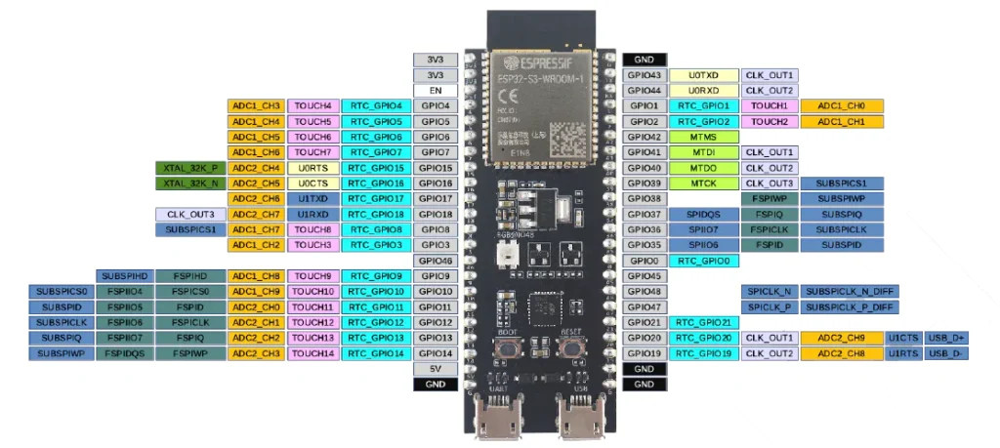

# Sentinel Node: arquitectura propuesta

## Estado y fuentes

Este documento conserva la exploración y la estrategia vigente confirmada por el usuario. Registra el alcance y las decisiones aprobadas; no acredita funcionalidades implementadas ni sustituye las specs de cada cambio. Se complementa con [decisiones técnicas](technical-decisions.md) y [roadmap](roadmap.md).

Los estados usados en los tres documentos son:

- **Confirmada:** instrucción expresa del usuario o requisito de referencia del brief/PDF. Se identifica su procedencia; no implica que el hardware haya sido validado.
- **Recomendación:** solución propuesta durante la exploración, pendiente de revisión.
- **Hipótesis pendiente de validar:** posibilidad técnica o comportamiento que requiere evidencia.

Fuentes de alcance:

- [Brief del proyecto](brief.md).
- PDF «Propuesta proyecto de Programación de artefactos (1).pdf», disponible durante la exploración en `/mnt/c/Users/Jefry/Downloads/Propuesta proyecto de Programación de artefactos (1).pdf`; páginas 4–7 para hardware, stack, comunicaciones y modos, y 9–12 para actividades. El PDF no se ha copiado al repositorio.
- Instrucción posterior del usuario: usar **ESP32-S3-DevKitC-1, 44 pines, ESP32-S3 N16R8 WiFi USB-C** y conservar el alcance del PDF. Cambiarlo solo ante una limitación demostrada o una alternativa claramente mejor y justificada.

La selección de placa está confirmada por el usuario y sustituye las referencias WROOM-32/WROVER del PDF.

**Actualización confirmada por el usuario el 2026-11-10:** desarrollo acelerado e incremental de los tres módulos en paralelo, incluido Auditor/Sanitizador desde la primera ronda. La entrega comprende Escudo, Sanitizador y Cebo con sus funcionalidades completas y app integrada. Un único modo ocupa la radio en cada ESP32. La base existente y sus resultados están documentados en firmware/EVIDENCE.md y docs/core-foundation-check.md. La planificación y los encargos individuales se describen en [encargos/README.md](encargos/README.md).

## Plataforma física

**Confirmada por el usuario:** la placa objetivo es la ESP32-S3-DevKitC-1 N16R8 descrita arriba.

La variante N16R8 figura con 16 MB de flash y 8 MB de PSRAM en la [guía oficial de Espressif](https://docs.espressif.com/projects/esp-dev-kits/en/latest/esp32s3/esp32-s3-devkitc-1/user_guide_v1.1.html). Esta capacidad nominal no equivale a memoria libre de aplicación ni a rendimiento validado.

**Pendiente de validar:** revisión física y correspondencia del pinout aportado con la unidad USB-C adquirida, detección de memorias, GPIO disponibles y alimentación. La base configura OLED SSD1306 por I2C en SDA GPIO8/SCL GPIO9 y botón GPIO4, ajustables mediante Kconfig; el cableado y funcionamiento físico siguen pendientes. Ver [guía de firmware](firmware.md). La alimentación portátil permanece como referencia del PDF.

### Pinout aportado por el usuario

**Confirmada:** el usuario proporcionó la siguiente imagen como referencia de pines para la placa seleccionada. Se conserva una copia local sin modificar; no se dispone del enlace original del fabricante de esta imagen.



La imagen muestra las dos hileras de 22 pines con la antena arriba y los conectores USB abajo. Las etiquetas GPIO identifican señales del chip, no posiciones consecutivas en el conector. Las funciones alternativas coloreadas no implican que todas puedan usarse simultáneamente ni que todos los GPIO estén disponibles en N16R8.


| Pines de la imagen           | Consideración para el proyecto                                                                                                                                   |
| ---------------------------- | ---------------------------------------------------------------------------------------------------------------------------------------------------------------- |
| `GPIO35`, `GPIO36`, `GPIO37` | La guía oficial los reserva para memoria octal en las variantes correspondientes. En N16R8 no deben seleccionarse para OLED, botón u otros periféricos externos. |
| `GPIO19`, `GPIO20`           | Señales USB nativo D− y D+, respectivamente; considerar su uso USB antes de asignarlas a periféricos.                                                            |
| `GPIO43`, `GPIO44`           | UART0 TX y RX, respectivamente; considerar programación y consola antes de reutilizarlas.                                                                        |
| `3V3`, `5V`, `GND`, `EN`     | Alimentación, tierra y habilitación; no son GPIO de uso general.                                                                                                 |


Las restricciones de memoria y las funciones USB/UART se contrastaron con la [guía de Espressif](https://docs.espressif.com/projects/esp-dev-kits/en/latest/esp32s3/esp32-s3-devkitc-1/user_guide_v1.1.html). **Pendiente de validar:** correspondencia con la revisión física, esquema de la unidad concreta y disponibilidad restante. **Recomendación:** usar esta referencia al revisar el futuro cableado; la imagen no constituye una asignación aprobada de SDA, SCL o botón.

## Componentes y límites

**Confirmada:** separación de firmware, broker, aplicación y simulador. La distribución de carpetas continúa siendo una propuesta de organización; no representa componentes ya implementados.

| Componente | Responsabilidad | Límite |
| --- | --- | --- |
| `firmware/` | Modos, radio, periféricos, detección, eventos, registro persistente, comandos y reconexión. | Un modo activo; Cebo sin acceso administrativo real ni exposición pública. |
| `broker/` | Mosquitto en Docker, autenticación, ACL y distribución MQTT. | No sustituye el registro local ni es por sí mismo una API histórica. |
| `app/` | React/Vite/Tailwind/Zustand con Capacitor Android; BLE, mqtt.js, dashboard, historial y notificaciones. | Solo presenta como aplicado un comando confirmado por el nodo; diferencia datos simulados y reales. |
| `simulator/` | Apoyo ligero para contratos, fixtures y reproducción de eventos. | No es una etapa previa obligatoria ni acredita una función de hardware. |
| `contracts/` | Contratos versionados de estados, métricas, incidentes, comandos y confirmaciones. | Ruta y formato de archivos por concretar en cambios pequeños. |
| Componente de notificaciones de R-10 | Consumir eventos autorizados, controlar repetición y entregar webhooks y push móvil. | Separado de la detección y del firmware; proveedor, ruta y alojamiento por concretar al implementar. No requiere diseñar una plataforma histórica compleja. |

**Stack confirmado:** PlatformIO + ESP-IDF + FreeRTOS con C/C++, Mosquitto/Docker y React/Vite/Tailwind/Zustand/Capacitor Android. Se seleccionan y fijan versiones compatibles en el primer incremento; se reutilizan componentes oficiales adecuados antes de crear alternativas propias.

El componente de notificaciones y la infraestructura de entrega son necesarios para el alcance aprobado; no constituyen una funcionalidad opcional posterior. La elección concreta del proveedor y su despliegue se aborda en el cambio correspondiente, sin una fase extensa de investigación.

## Comunicación según el modo

```text
ESCUDO PASIVO
[Redes 2.4 GHz] -- escucha --> [ESP32-S3: captura]
                                      ^
                                      | BLE autenticado
                                      v
                               [App Android]
                                      |
                         [Dashboard / historial]

Sin asociacion Wi-Fi ni MQTT directo en Escudo.

CEBO DE RED LOCAL
[Clientes LAN] --> [ESP32-S3: HTTP / Telnet ficticios]
                                      ^
                                      | MQTT/TLS
                                      v
                                 [Mosquitto]
                                  ^       |
                                  |       v
                           MQTT/WSS  [Notificaciones]
                                  |       |
                                  v       +--> [Webhook]
                            [App Android]       |
                                  ^       |
                                  |       v
                                  +--- [Push movil]
                                       app cerrada

[Simulador] <-- MQTT --> [Mosquitto]   (apoyo separado)
```

**Decisiones confirmadas:** BLE para descubrir redes, seleccionar objetivo, controlar y recibir resultados del Escudo; MQTT para Cebo. TLS/WSS, identidades y ACL según R-04; autorización BLE según R-03/R-07. Los puertos concretos, credenciales de integración, protocolo BLE y despliegue se concretan en sus cambios, sin secretos en el repositorio o logs.

El control remoto utiliza el canal disponible. En Escudo no se enviarán órdenes al nodo por MQTT ni se lo asociará a una red para recuperar ese canal. Al pasar a Cebo se establece la conexión autorizada y MQTT; al volver a Escudo se detienen servicios y conexión Wi-Fi. La app reconcilia el resultado de una transición si se interrumpe el canal que la inició.

Internet y broker accesible son condiciones distintas: MQTT puede operar mediante un broker en LAN sin Internet. Webhooks y push externos dependen de conectividad e infraestructura; mostrar su indisponibilidad no sustituye su implementación.

### Contratos y entrega

**Confirmados por R-05 y usuario:** contratos versionados, identificación de eventos, comandos idempotentes, revisión esperada, caducidad verificable, confirmaciones y deduplicación. La versión exacta de MQTT, topics/QoS y forma del protocolo BLE todavía se concretarán; no se anuncian como seleccionados.

Conservar identidad del nodo, identificador de arranque, secuencia, modo, origen real/simulado y marca temporal con calidad. Si no existe hora confiable en Escudo, establecer la referencia temporal mediante la app BLE y conservar tiempo monotónico; no abrir una conexión Wi-Fi para sincronizarlo. No inventar fechas cuando no exista referencia válida.

El acuse del transporte no acredita aplicación del comando ni recepción final por el dashboard. La recuperación del historial y la confirmación de transición usan los contratos compartidos, con límites explícitos y sin duplicar incidentes.

## Organización interna del firmware

**Confirmada por R-02 y usuario:** supervisor central, gestión común de radio y exclusión de modos. Las tareas y tamaños concretos se determinan al implementar.

```text
[BLE]    [MQTT, solo modos con conexion]    [Boton]
   |                 |                       |
   +-----------------+-----------------------+
                     v
          [Supervisor de modos]
                     |
         +-----------+-----------+
         v           v           v
     [Escudo]     [Cebo]   [Sanitizador]
         |           |           |
         +-----------+-----------+
                     v
            [Gestor Wi-Fi / BLE]

[Modulos] --> [Colas acotadas] --> [Registro persistente]
                     |                    |
                     v                    v
               [Estado / OLED]    [BLE o MQTT / app]
```

| Módulo interno | Responsabilidad |
| --- | --- |
| Supervisor | Serializar órdenes, detener el modo anterior, aplicar transición y confirmar o informar error. |
| Gestor de radio | Captura/BLE en Escudo, STA/MQTT en Cebo y STA+AP/NAT en Sanitizador, con liberación serializada al cambiar de modo. |
| Escudo | Descubrimiento, objetivo, captura, detectores, métricas e incidentes pasivos. |
| Cebo | HTTP/Telnet simulados, detección, clasificación y límites de recursos. |
| Registro | Persistencia circular limitada, pendientes, recuperación y deduplicación. |
| Adaptadores | Validar y transportar contratos, sin decidir modos por separado. |
| Interfaz física | Mostrar estado y tramitar órdenes del botón mediante el supervisor. |

**Recomendación de implementación conservada:** callbacks breves y colas acotadas. No fijar prioridades, afinidades ni optimizaciones sin necesidad funcional.

## Alcance obligatorio del Módulo 1: Escudo Pasivo

Todas estas funciones forman parte del MVP, conforme a R-03 y la instrucción vigente:

- Escaneo pasivo 2.4 GHz; SSID, BSSID, canal, RSSI y seguridad anunciada; catálogo enviado al dashboard mediante BLE.
- Selección por SSID/BSSID, inicio, detención y cambio de red desde la app.
- Captura promiscua real y análisis Beacon, Deauthentication y Disassociation; prioridad al objetivo y recorrido de canales para anomalías relacionadas.
- Ráfagas de desautenticación, desconexiones sospechosas y heurísticas Evil Twin comparando BSSID del mismo SSID, canales, RSSI y seguridad. No asumir que SSID duplicado significa ataque.
- Indicios compatibles con Karma observables pasivamente, con sus limitaciones documentadas; sin pruebas activas para forzar una conclusión.
- Eventos, métricas y alertas BLE; gráficos de actividad/volumen, tabla de incidentes con red, canal y tiempo, historial y recuperación de pendientes tras desconexión.
- Estado OLED y control físico por botón.

**Restricciones conservadas:** sin asociación a la red auditada, MQTT directo, NAT ni auditoría DNS/HTTPS. Alertas como indicios cuando no sean concluyentes; ausencia de alertas no certifica una red segura.

**Tratamiento confirmado de H-03:** intentar BLE/captura concurrentes durante implementación. Si fallan, sincronización periódica o pausas controladas, sin retirar descubrimiento, control ni detectores. La interfaz identifica periodos sin cobertura. No se exige un benchmark previo; se conserva la referencia técnica de [coexistencia ESP32-S3](https://docs.espressif.com/projects/esp-idf/en/v5.4/esp32s3/api-guides/coexist.html).

## Alcance obligatorio del Módulo 3: Cebo de Red Local

Todas estas funciones forman parte del MVP, conforme a R-10 y la instrucción vigente:

- STA en LAN autorizada; panel administrativo HTTP ficticio y Telnet simulado en puerto 23.
- Detección de conexiones, accesos e intentos de autenticación, sin ejecutar comandos ni exponer administración real.
- IP de origen, puerto, protocolo, fecha/hora, calidad temporal, tipo de interacción, cantidad y frecuencia; clasificación y detección de repetición/patrones sospechosos.
- Eventos/métricas MQTT, dashboard en tiempo real, historial, incidentes y alertas visibles.
- Integraciones reales con webhooks y notificaciones push Android, incluyendo recepción con la aplicación cerrada y control de repetición.
- Registro local persistente con búfer circular limitado, conservación de pendientes, sincronización al recuperar MQTT e identificación/deduplicación.

**Restricciones conservadas:** redes propias o autorizadas, límites de conexiones/tiempos/tamaños, servicios sin exposición pública ni redirección de puertos, sin contraseñas/tokens/credenciales reales ni cuerpos completos registrados. Una conexión aislada no demuestra compromiso. Al salir del modo se cierran servidores y conexiones.

## Transiciones y recursos

Solo un modo operativo activo. Arranque, reposo, transición y error pueden representarse como estados técnicos sin añadir modos de producto.

```text
[ARRANQUE] --> [REPOSO]
[Modo A] --> [DETENIENDO] --> [CONFIGURANDO] --> [Modo B]
                   |                |
                   +----> [ERROR] <-+
```

La política detallada de recuperación se concreta en el incremento del supervisor. Durante la integración comprobar brevemente cierre de servicios, exclusión, confirmaciones y recuperación tras fallo. Desarrollar módulos 1 y 3 en paralelo significa trabajo sobre componentes independientes, no captura y Cebo ejecutándose a la vez.

OLED, botón, autenticación y reconexión se integran desde la base. La etapa final los comprueba en conjunto, no aplaza su implementación.

## Persistencia, historial y funcionamiento offline

**Confirmados por R-06/R-10 y usuario:** registro local persistente y circular con capacidad limitada, pendientes y sincronización/deduplicación. Resolver mediante almacenamiento sencillo adecuado al ESP32; API/medio, capacidad, retención y política al llenarse se documentarán en el incremento respectivo. No se requiere diseñar una base de datos compleja ni hacer ensayos extensos de desgaste previamente.

| Condición | Comportamiento obligatorio |
| --- | --- |
| Escudo sin BLE | Continuar observación y registro según recursos; recuperar pendientes cuando vuelva BLE. |
| Cebo sin broker | Mantener servicios locales y eventos persistentes; sincronizar al restablecer MQTT. |
| Sin Internet, broker LAN accesible | Mantener MQTT local y mostrar disponibilidad de alertas externas. |
| Reinicio breve | Recuperar los registros persistidos y reconciliar identificadores; no prometer memoria ilimitada ni cero pérdidas en cualquier corte. |
| Recuperación del canal | Entregar estado y pendientes sin duplicar el historial ni aplicar órdenes vencidas. |

Zustand conserva el estado de interfaz; IndexedDB continúa como alternativa por concretar para historial recibido. Un registro histórico central completo no es requisito añadido. El componente de notificaciones de R-10 sí es parte de la arquitectura necesaria; no debe confundirse con una plataforma de almacenamiento histórico adicional.

## Dashboard Android y notificaciones

**Confirmado:** React, Vite, Tailwind, Zustand y Capacitor Android; BLE/MQTT según modo, catálogo y selección/configuración de redes, comandos confirmados, gráficos, métricas, incidentes, alertas, historial y notificaciones. Mostrar datos antiguos y pérdidas de cobertura.

El canal push debe entregar al teléfono con la app cerrada mediante infraestructura real; las alertas en primer plano no lo sustituyen. El webhook sigue siendo una integración adicional obligatoria. El componente de notificaciones controla repetición y separa secretos propios de integración del firmware, repositorio y logs. Proveedor y mecanismo de registro del dispositivo se fijan al abordar ese cambio acotado; no se adjudica aquí una tecnología no aprobada.

Comprobar funcionalmente cada canal, incluida app cerrada, antes de cerrar el MVP. Las campañas extensas de compatibilidad, segundo plano y estabilidad pueden hacerse después. Cuando Android o la conectividad impidan una entrega, registrar la condición y corregir fallos básicos sin prometer recepción incondicional.

## Auditor y Sanitizador en desarrollo paralelo

**Confirmado por la instrucción del 2026-11-10:** el responsable del Módulo 2 comienza en paralelo con los demás. Su alcance comprende diagnóstico DNS/HTTPS/portal cautivo, STA+AP/NAT IPv4, clientes/tráfico/RSSI, DNS local/Sinkhole y DoH. H-04/H-05 se comprueban durante sus incrementos y los resultados se registran en hardware.

```text
[Cliente] <-- Wi-Fi --> [SoftAP ESP32-S3]
                               |
                    +----------+----------+
                    v                     v
                [NAT IPv4]          [DNS local]
                    |                     |
                    v                     v
                  [STA]           [Bloqueo / cache]
                    |                     |
                    v                     v
          [Router autorizado]      [Cliente DoH]
```

La implementación progresiva y las políticas de R-08 guían sus cambios. Las comprobaciones de NAT/DoH se ejecutan dentro de esa línea de trabajo. El filtrado cubre las consultas atendidas por el DNS local y la primera pasarela utiliza IPv4.

## Validaciones y preparación para desarrollo

**Orden confirmado:** completar y verificar la base mientras se preparan contratos, desarrollar Escudo, Sanitizador, Cebo y app en paralelo, e integrar los tres modos. El [roadmap](roadmap.md) y los encargos concretan las dependencias.

**Comprobaciones obligatorias durante implementación:** compilación, conectividad y comportamiento funcional breves; pruebas focalizadas para lógica crítica, parser/clasificación, límites, comandos, transiciones, persistencia y deduplicación. Corregir fallos bloqueantes y continuar. Comprobar hardware, BLE, MQTT y notificaciones con dispositivos reales; simulación y mocks solo apoyan pruebas.

**Mejoras posteriores:** benchmarks, pérdida de tramas exhaustiva, carga prolongada, resistencia de memoria, estabilidad, autonomía y optimización; atender antes únicamente problemas que impidan funcionamiento básico.

Las hipótesis H-01 a H-08 registran resultados pendientes, no puertas de investigación previas. Stack, supervisor, alcance completo del MVP y transporte por modo ya están confirmados. Versiones, límites iniciales, pines, proveedor de notificaciones y detalles de contratos se resuelven de manera concreta en sus cambios; solicitar revisión de una decisión arquitectónica nueva importante sin reabrir acuerdos existentes.

Los nuevos cambios OpenSpec contienen propuestas de diseño para revisión y tareas de implementación pendientes. Las fichas de docs/encargos permiten trabajar con esos contratos y criterios desde ramas individuales.
