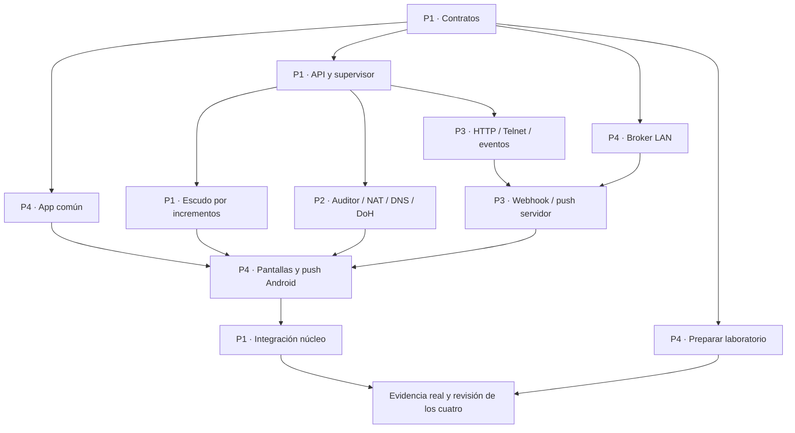

# Reparto de Sentinel Node para cuatro integrantes

Estado: de los **23 encargos originales**, `sentinel-module-contracts` está implementado, aprobado por el usuario y [archivado con 7/7 tareas](../../openspec/changes/archive/2026-11-11-sentinel-module-contracts/closure.md). Sus seis requisitos están en la [spec principal](../../openspec/specs/module-protocol/spec.md), con [resultados y límites](../../contracts/evidence-v2.md). Los otros **22 cambios** conservan su estado de planificación; consultar sus tareas y evidencia antes de empezar. La publicación está separada en [PR #2: contratos](https://github.com/Jefry-P/ArtefactosProyecto/pull/2) y [PR #3: planificación y guías](https://github.com/Jefry-P/ArtefactosProyecto/pull/3), ambos hacia develop. Integrar #2 antes de #3; esta publicación no realizó merges.

Verificación de la planificación original: `openspec validate --all --strict --json` aprobó los 24 cambios que estaban presentes (23 nuevos y la base), sin incidencias. Se comprobaron enlaces locales, ausencia de ciclos entre encargos y asignación de un único autor. Es evidencia de aquella planificación, no una afirmación de que todos los módulos estén implementados o físicamente verificados.

## Guías personalizadas: empezar aquí

Leer primero la [guía común del equipo](guia-equipo.md): cómo encontrar requisitos, consumir contratos, preparar una rama y entregar evidencia sin tener que aprender OpenSpec.

| Integrante | Guía y recorrido de trabajo |
| --- | --- |
| Persona 1 — Jefry | [Coordinación, contratos, API, Escudo e integración](guia-persona-1.md). Incluye cómo aplicar cada cambio con OpenSpec y hacer seguimiento de las entregas del equipo. |
| Persona 2 | [Auditor/Sanitizador completo](guia-persona-2.md): auditoría → pasarela/NAT → DNS → DoH, contratos, pruebas y coordinación con núcleo/app. |
| Persona 3 | [Cebo y servidor de alertas](guia-persona-3.md): HTTP → Telnet → eventos/persistencia → webhook → push servidor. |
| Persona 4 | [App, broker LAN y laboratorio](guia-persona-4.md): base común → infraestructura y pantallas → push Android y evidencia conjunta. |

Las guías explican el reparto aprobado; las fichas y sus specs conservan el detalle de tareas y aceptación. Un cambio sigue teniendo un solo autor. La existencia de una guía no autoriza Git ni convierte una propuesta en comportamiento implementado.

## Reparto confirmado y responsabilidad

**Ajuste confirmado el 2026-11-11:** se elimina Telegram del alcance de Cebo y de P3. Se mantienen alertas en la app, webhook y push móvil; el encargo se llama ahora `sentinel-alertas-webhook`. El reparto conserva los mismos responsables y cinco encargos de P3.

El usuario coordina OpenSpec y desarrolla Escudo. El Sanitizador comienza desde la primera ronda, por instrucción del 2026-11-10; los tres módulos conservan todo su alcance funcional. Solo un modo usa la radio a la vez en cada ESP32.

| Integrante        | Trabajo propio                                                                   | Cambios nuevos |
| ----------------- | -------------------------------------------------------------------------------- | -------------- |
| Persona 1 — Jefry | Contratos, API/supervisor, Escudo, integración del núcleo y seguimiento OpenSpec | 7              |
| Persona 2         | Auditor/Sanitizador completo                                                     | 4              |
| Persona 3         | Cebo completo y envío de webhook/push                                   | 5              |
| Persona 4         | App de los tres modos, recepción push Android, broker LAN y laboratorio          | 7              |

Los números no representan esfuerzo equivalente. Persona 4 tiene la mayor variedad: debe adelantar la base de app y broker, reutilizar componentes de UI y coordinar evidencia. Persona 3 se encarga del servidor de alertas para repartir infraestructura. No se inventan fechas, nombres de compañeros ni disponibilidad de otras placas. Con una sola ESP32, acordar turnos de pruebas breves; el trabajo de carpetas separadas avanza en paralelo.

**Un cambio = un autor.** No hay una spec compartida entre firmware y UI, ni entre envío y recepción push. El revisor es otro integrante y no toma tareas de implementación dentro del mismo cambio. Si alguien necesita ayuda, se transfiere el encargo completo de forma explícita o se crea otro cambio acotado; no asignar simultáneamente sus casillas a dos personas.

## Antes de implementar: revisión concreta, sin otra investigación extensa

Alcance, stack, transporte por modo, exclusión de modos y contrato v2 ya están aprobados. El contrato del punto 1 está completado; las elecciones de implementación nuevas de los consumidores de los puntos 2 y 3 conservan su condición de **propuestas para revisión**, según AGENTS.md:

1. [Protocolo v2 compatible con la base e historial v1](../../openspec/changes/archive/2026-11-11-sentinel-module-contracts/design.md): biblioteca implementada, probada y aprobada por el usuario; consultar [contrato para consumidores](../../contracts/module-protocol.md) y [evidencia de aprobación](../../contracts/evidence-v2.md). La base conserva v1 hasta que sus consumidores se adapten; no admite campos funcionales por simple adición. `origin` en eventos v2 es obligatorio y conserva el formato histórico v1.
2. [API de módulos y único propietario de radio/journal](../../openspec/changes/sentinel-firmware-module-api/design.md): concreta las interfaces para que los tres autores integren sin editar el mismo núcleo.
3. [Componente mínimo Node y API de notificaciones](../../openspec/changes/sentinel-alertas-webhook/design.md), [FCM servidor](../../openspec/changes/sentinel-alertas-push-servidor/design.md) y [plugin Android](../../openspec/changes/sentinel-app-push/design.md): proveedores/credenciales locales se aprovisionan al implementarlos. No se ha creado un proyecto Firebase ni acreditado entrega real.

Los límites de conexiones, umbrales, cachés y tiempos son recomendaciones iniciales documentadas en cada diseño. Ajustarlos ante fallos no reduce funciones. H-01 a H-08 siguen siendo validaciones durante implementación; NAT, DoH, concurrencia y push no están demostrados por estos archivos. No hacen falta benchmarks previos.

## Orden de trabajo

1. La [base archivada](../../openspec/changes/archive/2026-11-10-sentinel-core-foundation/closure.md) conserva **26/45 tareas verificadas y 19 comprobaciones pendientes aceptadas por el usuario** bajo la suposición de que el hardware funciona. Esta aceptación permite continuar sin marcar esas pruebas como realizadas. Cuando se ejecuten, registrar evidencia con la [guía de prueba](../core-foundation-test-guide.md).
2. Continuar con la API de módulos, consumiendo el contrato aprobado y archivado. Son dos encargos separados: el contrato está terminado y la API sigue pendiente. Los compañeros leen sus interfaces para preparar su carpeta; no se exige terminar todas las comprobaciones de base para empezar lógica/UI. Confirmar que la referencia compartida contiene ambos PR y las dependencias necesarias: publicar no equivale a integrar en develop.
3. Primera ronda en paralelo: tú descubrimiento Escudo; P2 auditoría; P3 HTTP; P4 adaptación app y broker (dos cambios suyos, uno por rama/PR). Cada uno necesita contrato/API que consuma.
4. Seguir la cadena interna de cada módulo y las pantallas independientes. La UI puede prepararse con fixtures revisados; sus dependencias de la tabla son de **integración/cierre**, no una prohibición de preparar vistas antes. Un fixture nunca cuenta como funcionalidad integrada.
5. P3 entrega webhook y servidor push; P4 integra recepción Android y prueba con app cerrada. P4 prepara laboratorio desde temprano y consolida evidencia durante todas las rondas.
6. Tú integras registros/recursos físicos del núcleo; cada fallo de un módulo o de la app vuelve a su autor. P4 consolida laboratorio. El cierre requiere Escudo, Sanitizador y Cebo completos en ESP32/app.

## Encargos y dependencias de integración

Las dependencias son entregas revisadas; no se asume ningún merge realizado. Dentro de una carpeta todos los cambios son del mismo autor. No trabajar simultáneamente en dos ramas propias que modifiquen el mismo archivo.

| Cambio y ficha                                                            | Autor | Depende de                                                                                                                    |
| ------------------------------------------------------------------------- | ----- | ----------------------------------------------------------------------------------------------------------------------------- |
| [sentinel-module-contracts](sentinel-module-contracts.md)                 | P1    | Base existente                                                                                                                |
| [sentinel-firmware-module-api](sentinel-firmware-module-api.md)           | P1    | `module-contracts`                                                                                                            |
| [sentinel-escudo-descubrimiento](sentinel-escudo-descubrimiento.md)       | P1    | `firmware-module-api`                                                                                                         |
| [sentinel-escudo-captura](sentinel-escudo-captura.md)                     | P1    | `escudo-descubrimiento`                                                                                                       |
| [sentinel-escudo-detectores](sentinel-escudo-detectores.md)               | P1    | `escudo-captura`                                                                                                              |
| [sentinel-escudo-recuperacion](sentinel-escudo-recuperacion.md)           | P1    | `escudo-detectores`                                                                                                           |
| [sentinel-sanitizador-auditoria](sentinel-sanitizador-auditoria.md)       | P2    | `firmware-module-api`                                                                                                         |
| [sentinel-sanitizador-pasarela](sentinel-sanitizador-pasarela.md)         | P2    | `sanitizador-auditoria`                                                                                                       |
| [sentinel-sanitizador-dns](sentinel-sanitizador-dns.md)                   | P2    | `sanitizador-pasarela`                                                                                                        |
| [sentinel-sanitizador-doh](sentinel-sanitizador-doh.md)                   | P2    | `sanitizador-dns`                                                                                                             |
| [sentinel-cebo-http](sentinel-cebo-http.md)                               | P3    | `firmware-module-api`                                                                                                         |
| [sentinel-cebo-telnet](sentinel-cebo-telnet.md)                           | P3    | `cebo-http`                                                                                                                   |
| [sentinel-cebo-eventos-historial](sentinel-cebo-eventos-historial.md)     | P3    | `cebo-telnet`                                                                                                                 |
| [sentinel-alertas-webhook](sentinel-alertas-webhook.md) | P3    | `module-contracts`, `broker-lan`, `cebo-eventos-historial`                                                                    |
| [sentinel-alertas-push-servidor](sentinel-alertas-push-servidor.md)       | P3    | `alertas-webhook`                                                                                                    |
| [sentinel-app-protocolo-v2](sentinel-app-protocolo-v2.md)                 | P4    | `module-contracts`                                                                                                            |
| [sentinel-app-escudo](sentinel-app-escudo.md)                             | P4    | `app-protocolo-v2`, `escudo-descubrimiento`, `escudo-detectores`, `escudo-recuperacion`                                       |
| [sentinel-app-sanitizador](sentinel-app-sanitizador.md)                   | P4    | `app-protocolo-v2`, `sanitizador-auditoria`, `sanitizador-doh`                                                                |
| [sentinel-app-cebo](sentinel-app-cebo.md)                                 | P4    | `app-protocolo-v2`, `cebo-eventos-historial`, `alertas-webhook`                                                      |
| [sentinel-app-push](sentinel-app-push.md)                                 | P4    | `app-protocolo-v2`, `app-cebo`, `alertas-push-servidor`                                                                       |
| [sentinel-broker-lan](sentinel-broker-lan.md)                             | P4    | `module-contracts`                                                                                                            |
| [sentinel-laboratorio-pruebas](sentinel-laboratorio-pruebas.md)           | P4    | `module-contracts`                                                                                                            |
| [sentinel-integracion-tres-modos](sentinel-integracion-tres-modos.md)     | P1    | `escudo-recuperacion`, `sanitizador-doh`, `cebo-eventos-historial`, `app-escudo`, `app-sanitizador`, `app-push`, `broker-lan` |

## Propiedad de archivos y solicitudes entre compañeros

| Zona                                                                  | Único autor | Cómo pedir un cambio                                                               |
| --------------------------------------------------------------------- | ----------- | ---------------------------------------------------------------------------------- |
| contracts/ y schemas/fixtures de contrato                             | P1          | Describir campo, unidad, límite y caso; el cambio entra por su spec de contrato    |
| Núcleo firmware, sentinel\_api, main, CMake global y sdkconfig        | P1          | P2/P3 entregan requisito de hook/config, P1 integra sin editar lógica ajena        |
| firmware/components/escudo y sus tests/docs                           | P1          | Hallazgo con observación/fixture y resultado esperado                              |
| firmware/components/sanitizador y sus tests/docs                      | P2          | Mismo procedimiento; P1 solo integra el registro en núcleo                         |
| firmware/components/cebo y sus tests/docs                             | P3          | Mismo procedimiento; no editar desde laboratorio                                   |
| notifications/ y su package/lock/Compose propios                      | P3          | P4 consume API HTTPS; entrega casos de error/registro                              |
| app/, package.json y package-lock.json raíz                           | P4          | Solicitar adaptador/UI/dependencia; P3 no añade paquetes al workspace raíz         |
| broker/                                                               | P4          | P3 solicita rol notify; P4 adapta permisos con pruebas negativas                   |
| simulator/, docs/lab y consolidación de evidencia                     | P4          | Cada dueño entrega evidencia; el coordinador no se convierte en autor de su módulo |
| docs/architecture, technical-decisions, roadmap y artefactos OpenSpec | P1          | Cambios aprobados de alcance/interfaz quedan registrados por coordinador           |

## Cobertura de funcionalidades obligatorias

| Funcionalidad                                                         | Entrega del dispositivo/servidor                | Pantalla o integración                                        |
| --------------------------------------------------------------------- | ----------------------------------------------- | ------------------------------------------------------------- |
| Escaneo pasivo, SSID/BSSID/canal/RSSI/seguridad y objetivo            | P1 escudo-descubrimiento                        | P4 app-escudo                                                 |
| Inicio/detención/cambio de red por BLE                                | P1 escudo-descubrimiento + captura              | P4 app-escudo                                                 |
| Beacon, Deauth, Disassoc, prioridad objetivo y recorrido              | P1 escudo-captura                               | P4 app-escudo                                                 |
| Ráfagas, desconexiones, Evil Twin contextual e indicios Karma pasivos | P1 escudo-detectores                            | P4 app-escudo, evidencia y límites                            |
| Eventos/métricas/alertas BLE, gráficos y tabla red/canal/tiempo       | P1 detectores + contrato                        | P4 app-escudo                                                 |
| Escudo offline/persistencia/sync/dedup/cobertura                      | P1 escudo-recuperacion + journal base           | P4 app-protocolo-v2 + app-escudo                              |
| Diagnóstico DNS/HTTPS/certificados/portal                             | P2 sanitizador-auditoria                        | P4 app-sanitizador                                            |
| STA+AP autenticado, DHCP, NAT IPv4/subred separada                    | P2 sanitizador-pasarela                         | P4 app-sanitizador                                            |
| Clientes, RSSI/calidad, subida/bajada                                 | P2 sanitizador-pasarela                         | P4 app-sanitizador                                            |
| DNS local, reglas/Sinkhole, excepciones, caché y bloqueos             | P2 sanitizador-dns                              | P4 app-sanitizador                                            |
| DoH TLS, no fallback plano, degradación y recuperación                | P2 sanitizador-doh                              | P4 app-sanitizador                                            |
| HTTP panel ficticio, conexiones/accesos/auth                          | P3 cebo-http                                    | P4 app-cebo                                                   |
| Telnet puerto23, conexiones/input/auth, sin ejecución                 | P3 cebo-telnet                                  | P4 app-cebo                                                   |
| IP/puertos/protocolo/tiempo, cantidad/frecuencia/sospecha             | P3 cebo-eventos-historial                       | P4 app-cebo                                                   |
| Journal circular persistente offline, recuperación/IDs/dedup          | P3 cebo-eventos-historial + journal base        | P4 app-protocolo-v2 + app-cebo                                |
| MQTT real, historial/incidentes/métricas/gráficos/alertas internas    | P3 cebo-eventos-historial                       | P4 app-cebo + broker-lan                                      |
| Webhooks, dedup y control de saturación                     | P3 alertas-webhook                     | P4 app-cebo consulta estado                                   |
| Push móvil incluso app cerrada                                        | P3 alertas-push-servidor                        | P4 app-push; teléfono real obligatorio                        |
| TLS/WSS, BLE autenticado, contratos/ACK/replay                        | P1 contratos + API + base                       | P4 broker-lan + app-protocolo-v2                              |
| OLED/botón, supervisor, cambios seguros y manejo de errores           | P1 firmware-module-api + integracion-tres-modos | P4 pantallas reflejan estado, laboratorio recoge evidencia    |
| Datos sensibles, límites y uso solo autorizado                        | Cada autor en su componente                     | P4 laboratorio verifica; no se guardan credenciales recibidas |

## Flujo diario sin conocer OpenSpec

1. El compañero abre su ficha y diseño, revisa las dependencias y usa su rama feat indicada. Cada ficha enumera los archivos que puede modificar y tareas pequeñas con comprobación.
2. Implementa una tarea, compila, realiza una comprobación breve y registra resultados. Mantiene pruebas focalizadas de parsers, reglas, límites, privacidad o dedup cuando sea lógica crítica.
3. Abre PR conforme a CONTRIBUTING con descripción, resultados y ficha/spec enlazadas. Al menos otro integrante revisa. No integrar cambios de contratos improvisados ni código ajeno sin acordarlo con su dueño.
4. Tú revisas coherencia con OpenSpec y actualizas casillas según evidencia. Los compañeros no necesitan CLI ni redactar propuestas. Si usas Codex para implementar, solicita explícitamente aplicar un cambio concreto; no aplicar los 23 juntos.
5. Después de integrar y comprobar cada cambio, tú gestionas sincronización/archivo por el flujo OpenSpec autorizado. No copiar deltas pendientes al inventario principal como si estuvieran terminados ni archivar la base con tareas pendientes.

## Qué queda pendiente y qué se difiere

**Pendiente durante implementación:** verificación física de la base; revisión/implementación de API de módulos y sus consumidores; captura/BLE, NAT+DoH conjunto, detectores y persistencia; cuentas propias de integraciones; CA/SAN LAN y recepción push cerrada. El contrato está aprobado, pero los diseños no acreditan hardware ni sustituyen pruebas reales.

**Después de la entrega funcional completa:** benchmarks, autonomía, carga prolongada, resistencia flash y campañas extensas de compatibilidad/estabilidad. Ningún detector, servicio, canal de alerta o función del Sanitizador se mueve aquí para declarar éxito antes.

Referencias: [arquitectura](../architecture.md), [decisiones e hipótesis](../technical-decisions.md), [roadmap](../roadmap.md), [contribución](../../CONTRIBUTING.md).
