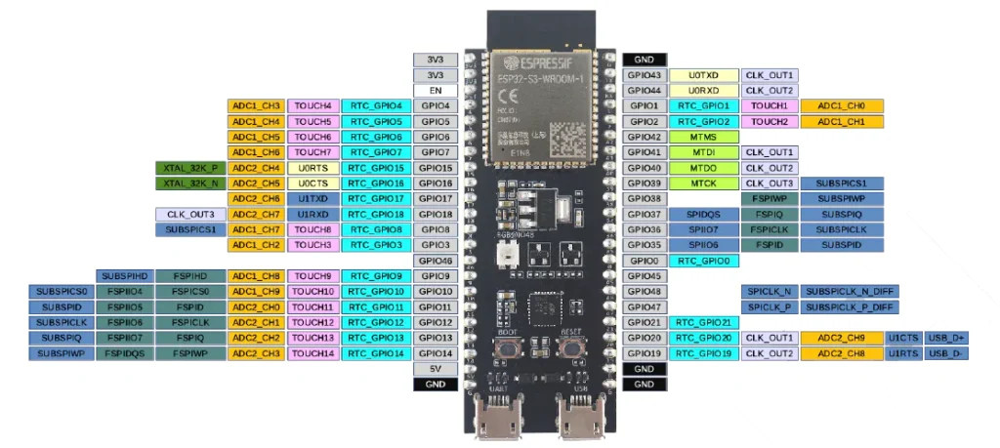

# Primera prueba de Sentinel Node — Persona 1 (Jefry)

**Estado actual:** [acuerdos del MVP y reparto](mvp-policy.md), [verificación integrada](../openspec/changes/sentinel-mvp-sin-cuentas/verification.md). MQTT sin TLS/cuentas/roles/ACL y correcciones de memoria/pila BLE incluidas. La tarea física4.3 sigue pendiente.

**Política vigente:** [persistencia y USB](persistence-policy.md). La primera carga de la tabla nueva requiere **Erase All Flash Before Sketch Upload: Enabled** y elimina datos previos; emparejar/configurar de nuevo. El estado del build final integrado se registra en la [verificación vigente](../openspec/changes/sentinel-mvp-sin-cuentas/verification.md); los builds/logs anteriores no prueban esta tabla.

Guía desde cero para Persona 1, con app v2 y adaptación **sin OLED** en `sentinel-p1-pruebas-sin-oled`. La fuente se mantiene con opciones de pruebas desactivadas; activarlas según 0.1. La [verificación de esta adaptación](../openspec/changes/sentinel-mvp-sin-cuentas/verification.md) identifica builds, APK y pendientes. Esta guía describe un procedimiento; no acredita pruebas físicas realizadas.

**Primera sesión:** cargar firmware con visualización serie, conectar el botón externo, instalar APK diagnóstico, emparejar por BLE y ejecutar T01–T15 con las condiciones de cada caso. Se añaden controles de diagnóstico para probar el firmware existente; las pantallas finales de P4, OLED real, ensayos RF de ataques y los módulos de los compañeros conservan sus entregas y comprobaciones pendientes.

## 0. Lee esto antes de copiar comandos

- **PowerShell:** terminal de Windows. Inicio → buscar PowerShell. Cuando se indique administrador, abrir con clic derecho → Ejecutar como administrador.
- **WSL / Ubuntu:** terminal Linux dentro de Windows. Inicio → Ubuntu. Allí se ejecutan los tests host y se compilan contratos/app; el firmware se compila y programa desde Arduino IDE Windows.
- **Teléfono:** Bluetooth y aplicaciones Android. No se necesita llevar el Bluetooth de Windows a WSL: la comunicación BLE es teléfono ↔ ESP32.
- Ejecutar los bloques en el orden indicado, una línea a la vez; esperar a que termine cada comando. No copiar las marcas de Markdown ni escribir un símbolo `$` delante.
- `COM_REAL` y los ejemplos de redes son marcadores: reemplazarlos antes de ejecutar. No asumir que la placa tendrá un nombre de puerto específico.
- Compilar genera archivos en la computadora. **Upload/grabar** transfiere el firmware a la ESP32. **Monitor** muestra su consola. **RESET/EN** reinicia; **BOOT** sirve para programación; el **botón externo GPIO4** controla Sentinel.

### 0.1. Activar las dos opciones de pruebas

1. En la copia del sketch que abrirás en Arduino, abre `SentinelConfig.h` y cambia únicamente:

   ```cpp
   #define SENTINEL_SERIAL_TEST_DISPLAY 1
   ```

   El valor de Git es `0`; activar `1` en el sketch que realmente vas a cargar. La copia opcional Windows del build integrado ya usa `1`. No cambies seguridad BLE ni flags de módulos. Selecciona **USB CDC On Boot: Disabled**, usa el conector **USB-UART** y abre **Monitor serie a 115200** antes de abrir la ventana BLE. El modo de pruebas acepta ausencia de OLED, pero sigue informando `peripherals.oled:false`.
2. Construye el APK con `VITE_SENTINEL_P1_TOOLS=1` según paso 11. Verifica que aparece **Diagnóstico P1**. El navegador permite revisar la interfaz pero las órdenes BLE requieren Android real.
3. El passkey se muestra como `[P1 PAIR CODE]` únicamente durante un intento real dentro de la ventana física. Introduce las seis cifras, incluidos ceros iniciales, en Android. **No guardes consola/capturas con ese código ni las adjuntes al repositorio.** UART confirma entrega al controlador, no que una persona haya abierto el monitor: mantenlo abierto antes de emparejar. Si pasó el código, cancela y repite el intento; no se reproduce automáticamente.
4. Al recibir OLED, vuelve a `SENTINEL_SERIAL_TEST_DISPLAY=0`, recompila/carga y genera APK sin la variable de diagnóstico. La pantalla del producto y su prueba física siguen siendo obligatorias. No hace falta borrar flash para RESET ni para probar persistencia.

### Qué está disponible en esta referencia

| Parte | Situación y qué esperar |
| --- | --- |
| Contratos, núcleo y API | Implementados; hay pruebas de software y pendientes físicos. |
| Escudo: descubrimiento, captura y cuatro detectores | Implementados en firmware, con control/eventos v2 por BLE. |
| Recuperación | Journal compartido conectado y comprobado por software; coexistencia y pruebas físicas pendientes. |
| App común v2, de P1 | Admite nodos v1/v2, BLE protegido, estado, modos disponibles, navegación común e historial paginado/deduplicado. Se puede probar con el firmware v2 actual. |
| Panel diagnóstico P1 | Disponible al compilar con `VITE_SENTINEL_P1_TOOLS=1`; scan, catálogo, selección, captura, estado, historial y negativos por BLE real. No sustituye la pantalla final. |
| Pantalla Escudo completa, de P4 | Siguen pendientes catálogo/selección, controles de captura, gráficos y detalle de incidentes. La navegación común no los implementa. |
| Cebo y Sanitizador | No registrados en los defaults actuales. No se espera que funcionen ni que el botón entre en ellos. |
| Alertas recientes en OLED e integración de tres modos | Trabajo pendiente de `sentinel-integracion-tres-modos`. La pantalla de estado actual no acredita ese resumen. |

Fuentes locales: [flujo y paquete Arduino](firmware.md), [pines y módulos habilitados](../firmware/SentinelNode/SentinelConfig.h), [app y versiones](../app/README.md), [transporte BLE](../app/src/transports/ble.ts) y [contrato v2](../contracts/module-protocol.md). Algunas guías de la fundación describen la versión inicial: usa las expectativas de esta guía para el firmware actual.

### Recorrido de tu primera sesión con v2

Para firmware basta Arduino IDE Windows con la integración oficial entregada; Node/WSL son mantenimiento opcional. Los pasos 2, 4.1, 4.3 y 5 preparan ese mantenimiento y la compilación de app; pueden omitirse para compilar/subir firmware si ya se dispone del APK de referencia. La app Android sigue siendo necesaria para las pruebas BLE.

1. Reunir el equipo (paso 1), revisar el checkout (paso 3) y completar la instalación inicial y Verificar de 4.2/6.
2. Completar pasos 7–10: cableado, USB, grabación y T01/T02.
3. Seguir pasos 11–13: instalar APK, conectar por BLE y ejecutar T03 desde los botones reales.
4. Ejecutar T14/T15 del paso 17: reconexión e historial básico, sin necesitar iniciar captura.
5. Activar **Diagnóstico P1** y ejecutar T04–T13 según las instrucciones de esta guía. T07/T12 tienen comprobaciones host; ataques reales, OLED y futuras integraciones siguen pendientes cuando falte su equipo o entrega.

No necesitas broker, Wi-Fi del teléfono ni contraseña de tu AP para el recorrido BLE básico. No es necesario conectar el teléfono por USB para usar BLE: ese cable y ADB solo son opcionales para instalar/diagnosticar Android; el USB de la ESP32 sí se utiliza aquí para programar y observar la consola.

## 1. Reunir el equipo

| Elemento | Para qué sirve |
| --- | --- |
| ESP32-S3-DevKitC-1 N16R8, 44 pines | Ejecutar Sentinel; se esperan 16 MiB de flash y 8 MiB de PSRAM. |
| Cable USB de datos | Alimentación, programación y consola. Un cable que solo carga no permite programar. |
| OLED SSD1306 I2C de **128×32**, dirección inicial `0x3C` | Opcional para esta sesión: monitor serie sustituye temporalmente estado y código BLE con la opción de pruebas habilitada. OLED física se prueba después. |
| Botón pulsador externo, cables Dupont y protoboard | Conectar GPIO4 a GND únicamente al presionar. |
| PC Windows con Arduino IDE 2 y core oficial ESP32 3.3.12 | Firmware nativo Windows; dos bibliotecas y configuración inicial documentadas en el paso4.2. WSL/Node se usan solo si haces mantenimiento host o compilas la app allí. |
| Teléfono Android con BLE | Emparejar y probar estado/modos/historial con tu app v2; el APK diagnóstico incluye controles de prueba del Escudo. |
| Red propia de **2.4 GHz** | Objetivo de observación. Escudo no se conecta ni necesita su contraseña. |

Para probar dos redes/canales necesitas otra red propia de 2.4 GHz, por ejemplo otro AP o un hotspot configurado a esa banda. Si no está disponible, esa parte queda pendiente; no inventar un resultado.

La primera prueba de Escudo no requiere broker Docker ni servicios de notificaciones. Esos componentes se incorporan a las pruebas conjuntas con P2/P3/P4.

## 2. Comprobar WSL 2 (opcional para mantenimiento/app)

**PowerShell:**

```powershell
wsl --list --verbose
```

Buscar Ubuntu con `VERSION 2`. Si ya existe, abrir Ubuntu y seguir al paso 3. Si falta WSL, desde PowerShell administrador:

```powershell
wsl --install
```

Reiniciar si lo solicita, abrir Ubuntu y crear su usuario Linux. Si Ubuntu figura como versión 1, usar su nombre exacto:

```powershell
wsl --set-version Ubuntu 2
```

Referencia: [instalación oficial de WSL](https://learn.microsoft.com/en-us/windows/wsl/install).

## 3. Abrir la entrega integrada

La referencia compartida es **develop**, con P1, correcciones BLE y MQTT anónimo integrados. Usa una entrega publicada que incluya este cambio; una rama o APK viejo no acredita qué versión ejecutas. No descartar cambios locales para cambiar de rama.

**Windows:** abrir `C:\Users\Jefry\Documents\Arduino\ArtefactosProyecto` y comprobar estado/referencia:

```powershell
Set-Location 'C:\Users\Jefry\Documents\Arduino\ArtefactosProyecto'
git status --short --branch
git log -1 --oneline
```

En Arduino IDE abrir `firmware\SentinelNode\SentinelNode.ino` desde esa raíz completa. Activar la opción serie según0.1 antes de Verificar/Upload. No copiar solo el .ino ni abrir el sketch de una entrega anterior.

**Ubuntu/WSL**, para app y mantenimiento:

```sh
cd /mnt/c/Users/Jefry/Documents/Arduino/ArtefactosProyecto
pwd
git status --short --branch
git log -1 --oneline
```

Opcionalmente, la copia local de la compilación integrada sin OLED está en `%LOCALAPPDATA%\Temp\sentinel-mvp-integrated\input\SentinelNode\SentinelNode.ino`. Tiene la opción serie1. Sus binarios y logs son artefactos locales, no fuentes versionadas ni prueba de que se haya cargado la ESP32. Los instaladores de bibliotecas/menú se ejecutan desde el repositorio completo.

## 4. Herramientas opcionales de mantenimiento y app

**Ubuntu / WSL:**

```sh
sudo apt-get update
sudo apt-get install -y git curl unzip usbutils ripgrep build-essential libssl-dev
```

`sudo` pedirá la contraseña de Ubuntu; al escribirla no se muestran caracteres. Estas herramientas permiten compilar las pruebas C++ del host y preparar app/contratos. No son requisitos del build Arduino. Los runners de firmware usan Node 24 y no requieren Python.

### 4.1. Node y npm del proyecto

Si existe `~/.nvm/nvm.sh`, cargarlo:

```sh
source "$HOME/.nvm/nvm.sh"
```

Si no existe, instalar nvm siguiendo su [repositorio oficial](https://github.com/nvm-sh/nvm#install--update-script). La versión consultada para esta guía permite:

```sh
curl -fsSL https://raw.githubusercontent.com/nvm-sh/nvm/v0.41.0/install.sh -o /tmp/sentinel-nvm-install.sh
bash /tmp/sentinel-nvm-install.sh
source "$HOME/.nvm/nvm.sh"
```

Desde la raíz:

```sh
nvm install
nvm use
node --version
npm --version
```

`.nvmrc` fija Node **24.13.1**. El proyecto declara npm **11.8.0**; si tu instalación muestra otra versión y necesitas reproducir ese entorno:

```sh
npm install -g npm@11.8.0
```

### 4.2. Arduino IDE y core oficial en Windows

Abrir Arduino IDE Windows y el `.ino` de la copia local completa indicada en el paso 3. La simplificación usa el core oficial ESP32 **3.3.12**, instalado en este equipo junto al SDK estándar, separado de la plataforma Sentinel anterior.

Seguir la [instalación inicial](firmware.md#instalación-inicial): instalar el core oficial **3.3.12** desde el IDE (sin ESP_SSLClient para MQTT); cerrarlo y ejecutar estos dos comandos en **PowerShell, desde la raíz del repositorio**:

```powershell
.\firmware\arduino\install-wolfmqtt.ps1
.\firmware\arduino\install-board-config.ps1
```

El primero descarga/verifica wolfMQTT2.2.0 y aplica su configuración. El segundo mantiene cuatro claves y retira cinco overrides Sentinel obsoletos, conservando otras opciones y respaldo. Ambos son repetibles y conservan respaldos cuando reemplazan archivos; no requieren SDK propio ni se ejecutan por compilación. Si PowerShell bloquea los scripts, ver la opción de política de alcance Process de firmware.md. Reiniciar Arduino IDE al terminar.

Después seleccionar **ESP32S3 Dev Module**, **16MB**, **QIO 80MHz**, **OPI PSRAM** y **Sentinel standard USB (4MiB factory, no OTA)**. Mantener **USB CDC On Boot: Disabled** para usar la consola UART0 de esta guía y **Erase All Flash Before Sketch Upload: Enabled** para la primera carga de la tabla nueva (después Disabled para no solicitar borrado total). Reiniciar el IDE si la nueva opción de particiones no aparece. La [tabla de opciones](firmware.md#seleccionar-placa-y-verificar) concentra estos valores.

El usuario aprobó hasta tres teléfonos recordados. Si había cuatro vínculos antiguos o datos incompatibles, el preflight debe detener BLE sin sobrescribirlos; no borrarlos para superar la comprobación. El build histórico del SDK propio y las pruebas aisladas de bibliotecas se distinguen del resultado final en la [verificación de dependencias](../openspec/changes/sentinel-arduino-dependencies/verification.md).

No instalar el SDK propio para cumplir el objetivo nuevo ni eliminar instalaciones globales. Los GPIO y flags del proyecto se revisan en `SentinelConfig.h`; no se cambian garantías mediante macros para ocultar errores.

### 4.3. Al abrir otra terminal Ubuntu

Para app/contratos y tests host:

```sh
cd /mnt/c/Users/Jefry/Documents/Arduino/ArtefactosProyecto
source "$HOME/.nvm/nvm.sh"
nvm use
```

El mantenimiento host requiere C/C++, OpenSSL y Node 24.13.1; los runners resuelven cJSON 1.7.19 por hash desde caché o descarga oficial. No activar un entorno PlatformIO. Mantener las herramientas npm de app/contratos en el mismo entorno Linux donde se instalaron sus dependencias.

## 5. Dependencias de app/contratos (opcional para firmware)

**Ubuntu / WSL, raíz:**

```sh
npm ci
```

Esperar a que termine sin error. Usa el lockfile del equipo. No cambiar dependencias ni generar otro lockfile para resolver un fallo de entorno sin revisarlo.

Comprobar las piezas de software:

```sh
npm run check:contracts
npm run test:app
npm run build
```

Resultado esperado: comandos sin fallos. `check:contracts` cubre el contrato compartido; `test:app` cubre negociación v1/v2, ACK, retención/boot/revisión, familias de eventos, dedup/páginas/gap y privacidad. `build` compila web/contratos. La verificación integrada registra156 tests de contratos y30 de app; las cifras anteriores se conservan en sus informes históricos. Estos resultados no prueban Bluetooth ni control con la placa.

Para ver la interfaz en Windows, mantener esta terminal abierta:

```sh
npm run dev
```

Abrir la URL que indique Vite (normalmente `http://localhost:5173`). Sin nodo, debe mostrar **Esperando un dispositivo**, sin redes ni incidentes inventados. El navegador sirve para UI/WS; **Buscar y conectar BLE** explica que requiere Android. Cerrar Vite con `Ctrl+C` cuando termines. En WSL sobre `/mnt/c`, si no refleja una edición, reiniciar Vite antes de probar otra vez.

## 6. Verificar firmware y mantenimiento opcional

**Arduino IDE Windows:** abrir el `.ino` de la copia local completa del paso 3 y pulsar **Verificar** con las opciones del paso 4.2. Esperar a que termine sin errores. No es necesario conectar aún la placa para compilar. El CLI nativo equivalente está en [firmware](firmware.md#comandos-windows-equivalentes); no sustituirlo por el FQBN del SDK anterior.

Arduino compila el validador local `src/sentinel/v2_validator.h`; no necesita Node/Python ni generar código antes de **Verificar**. El build final oficial terminó **exit0**, imagen **1376726 bytes**, variables globales **160228 bytes**. Su [evidencia](../openspec/changes/sentinel-arduino-dependencies/verification.md) distingue esas cifras de la memoria que debe informar tu placa. El build anterior con SDK propio se conserva como antecedente.

**Mantenimiento opcional en Ubuntu/WSL**, con Node24, compilador C/C++ y OpenSSL:

```sh
SENTINEL_SANITIZE=1 npm run test:firmware
SENTINEL_SANITIZE=1 npm run test:escudo
node firmware/test/arduino_build_test.mjs
```

| Prueba | Qué demuestra |
| --- | --- |
| `test:firmware` | Lógica del núcleo, comandos, supervisor, journal y paridad con contratos. |
| `test:escudo` | Descubrimiento, parser/captura, cuatro detectores y recuperación entre procesos host. |
| `arduino_build_test.mjs` | Flags/factories y guardas del core oficial y transportes; no sustituye el build completo. |

Los dos runners ya compilan C++; no repetir cada `run_host.mjs`. cJSON 1.7.19 se reutiliza de caché o se recupera con hash fijado. La auditoría `check_migration.mjs` usa el mapa externo preservado para este trabajo, no es un requisito diario del equipo. El checker de configuración ya inspecciona el header efectivo del SDK oficial y sus particiones; no prueba memoria física ni el enlace BLE negociado.

Se esperan `PASS` sin fallos de sanitizer. [Legibilidad](../openspec/changes/sentinel-firmware-readability/verification.md) y [limpieza](../openspec/changes/sentinel-firmware-cleanup/verification.md) registran las comprobaciones ya ejecutadas: núcleo con 69 fixtures v2, Escudo con cuatro detectores y recuperación de seis eventos únicos/seis repetidos. Esta guía no vuelve a declarar ejecutadas esas pruebas ni acredita radio/NVS físicos.

**Punto de control A:** conservar y resolver fallos de software antes de atribuirlos al cableado. La falta de placa permite continuar el software; las pruebas físicas conservan sus pendientes.

## 7. Cablear con la ESP32 desconectada

Retirar el USB antes de mover cables. **Sin OLED, omite su tabla y conecta solamente el botón GPIO4–GND.** No hace falta puentear SDA/SCL. Cuando llegue la pantalla, leer sus etiquetas; el orden de terminales puede variar.

| OLED | ESP32 |
| --- | --- |
| VCC | `3V3`, con módulo compatible con esa alimentación |
| GND | `GND` |
| SDA | `GPIO8` / `IO8` |
| SCL | `GPIO9` / `IO9` |

| Botón externo | ESP32 |
| --- | --- |
| Un contacto | `GPIO4` / `IO4` |
| Contacto que se une al anterior **solo al presionar** | `GND` |

El firmware activa pull-up interno: no hace falta añadir una resistencia para esta conexión inicial. En un pulsador de cuatro patas, dos pueden estar ya unidas internamente: escoger contactos que realmente cambien al presionar. Si tienes multímetro, comprobar continuidad antes de conectar.

`GPIO8` significa el pin etiquetado IO8, **no el octavo terminal del conector**. No conectar el botón a 3V3 ni usar BOOT como sustituto del botón externo.



Usar etiquetas y revisión de la unidad real. En la configuración actual se evitan GPIO35–37 por memoria octal, 19/20 por USB y 43/44 por UART. La placa del usuario puede diferir mecánicamente de la oficial; ver [guía de Espressif](https://documentation.espressif.com/api/resource/path/docs/projects/esp-dev-kits/en/latest/esp32s3/esp32-s3-devkitc-1/user_guide_v1.0.html) y [configuración de periféricos](../firmware/SentinelNode/SentinelConfig.h).

Si tu pantalla es **128×64**, SH1106, SPI o tiene otra dirección, comunicarlo antes de dar por fallido el proyecto: esta imagen de firmware usa SSD1306 **128×32 / 0x3C**. Cambiar resolución requiere adaptar el driver; cambiar dirección/pines se hace mediante configuración revisada.

## 8. Conectar USB e identificar el COM en Windows

1. Conectar cable de datos al conector **USB-UART/UART** según su etiqueta, para la consola UART0. No elegir por izquierda/derecha de una foto.
2. Abrir Administrador de dispositivos → Puertos e identificar el COM que aparece con esa placa. Un COM Bluetooth no identifica ESP32.
3. Si no aparece el puente USB, revisar cable/conector y su identificador antes de instalar un driver. No asumir CP210x/CH34x.

**PowerShell:**

```powershell
Get-CimInstance Win32_SerialPort | Select-Object DeviceID, Name, PNPDeviceID

```

Seleccionar ese COM en Arduino. Si hay varios equipos, confirmar cuál pertenece al usuario antes de programar. No es necesario adjuntar USB a WSL ni instalar usbipd para este flujo; Windows debe conservar el acceso a la placa.

La detección registrada el 2026-11-13 solo mostró COM3/COM4 de Bluetooth y ningún teléfono en ADB. No se grabó ni monitorizó un dispositivo; T01–T03/T14–T15 siguen pendientes de hardware.

## 9. Grabar la ESP32

Cerrar monitores que ocupen el puerto. Confirmar **Partition Scheme: Sentinel standard USB (4MiB factory, no OTA)** y seleccionar **Erase All Flash Before Sketch Upload: Enabled** para esta primera carga con tabla nueva. Elegir el COM real y pulsar **Subir**. La receta oficial escribe bootloader, tabla, `boot_app0` en0xe000 reservado a `otadata` y aplicación. Se pierden datos anteriores; después poner Disabled para no solicitar borrado total en cargas normales. USB posterior tampoco garantiza conservar datos.

No hay migración entre versiones. Emparejar/configurar de nuevo y, si quedan vínculos/caché antiguos del teléfono, retirarlos y reconciliar identidad/cursores en la app. `merged.bin` es imagen de inicialización sin garantía de preservar NVS. En reinicio normal sin upload, conservar identidad, bonds, configuración e historial confirmado; error NVS visible sin formato automático. Un build no acredita ninguna de estas pruebas físicas.

Tras disponer del procedimiento y ejecutar la subida, esperar escritura/verificación correctas. Si queda en `Connecting…`, revisar puerto/cable y seguir BOOT/RESET de la placa; no borrar flash. Ver [modo de arranque ESP32-S3](https://docs.espressif.com/projects/esptool/en/latest/esp32s3/advanced-topics/boot-mode-selection.html).

## 10. Leer el arranque y probar hardware básico

Abrir **Monitor serie** en Arduino a **115200** después de la subida verificada. No se necesita Node ni WSL para el monitor.

Con el monitor abierto, pulsar RESET/EN. Para cerrarlo, cerrar el panel **Monitor serie** del IDE; `Ctrl+C` solo se usa si ejecutas un monitor desde una terminal.

Buscar una línea parecida a esta; los IDs son ilustrativos:

```text
Sentinel 0.1.0 device=node-... boot=... flash=16777216 psram=8388608 profile=idle revision=0
```

### Prueba T01 — Memoria, identidad y pantalla

1. Anotar commit, puerto, `device`, `boot`, flash y PSRAM.
2. Confirmar flash **16777216 bytes** y PSRAM **8388608 bytes** en la lectura real, no en el resumen de compilación.
3. Sin OLED y con modo serie, confirmar `[P1 DISPLAY] OLED ABSENT` seguido del perfil/fase/conectividad/diagnóstico. En app debe seguir figurando OLED no disponible. Si aparece `OLED unavailable; new pairing disabled`, revisa la opción, recompila y vuelve a cargar. Con modo de producto, ese bloqueo sigue siendo correcto.
4. Pulsar RESET otra vez: `device` debe mantenerse; `boot` debe cambiar. El inicio es Idle.

Si falta PSRAM o su tipo no coincide, ESP-IDF puede detenerse antes de la línea Sentinel. Sin OLED puede aparecer un NACK al sondear I2C `0x3C`; es esperable con ese periférico desconectado si después aparece `[P1 DISPLAY] OLED ABSENT` y el modo serie funciona. Con OLED instalada, revisar alimentación, SDA/SCL, dirección y resolución si permanece negra. Sin OLED, la salida serie permite continuar; no marques aprobada la pantalla física.

### Prueba T02 — Botón externo

1. Pulsar brevemente GPIO4 y soltar: desde Idle debe entrar en Escudo si no hay fallo de recursos.
2. En la referencia actual solo está registrado Escudo; otro toque corto puede conservar Escudo. No debe inventar Cebo/Sanitizador.
3. Mantener pulsado al menos tres segundos y soltar: abre una ventana de emparejamiento de 120 segundos; soltar no debe ejecutar además el toque corto.
4. El código aparece **durante el intento de emparejamiento**, no necesariamente al abrir la ventana. No confundir esa espera con una pantalla averiada.
5. RESET permite volver a Idle. El regreso por comando se prueba después con el cliente v2.

**Punto de control B:** consola, memoria, visualización local y botón funcionan; OLED física queda pendiente si no está conectada. Esto todavía no demuestra captura o comandos desde teléfono.

## 11. Generar e instalar tu APK v2

La app de esta adaptación es v2 y añade el panel optativo P1. Para esta primera sesión **no necesitas esperar otro APK de P4**. Sí necesitas reconstruir/instalar el APK de la referencia que vas a probar; una instalación anterior no se actualiza al editar el repositorio.

### 11.1. Generar el APK

Si todavía no tienes JDK 21 y SDK Android Linux configurados, completar primero el **anexo A**. Volver a la raíz en Ubuntu, con Node y ese entorno cargados:

```sh
VITE_SENTINEL_P1_TOOLS=1 npm run android:sync
npm run android:assemble
ls -lh app/android/app/build/outputs/apk/debug/app-debug.apk
```

`android:sync` primero compila web y copia sus assets al proyecto Android; `android:assemble` empaqueta esos assets. Repetir ambos tras cambiar la app. Esperar a `BUILD SUCCESSFUL`. Si falla, no instalar un APK antiguo como si fuera el nuevo.

### 11.2. Instalar copiando el archivo (opción sencilla)

1. Para la copia ya generada de esta adaptación, abrir `C:\Users\Jefry\Documents\Arduino\ArtefactosProyecto\.cache` y usar **sentinel-mvp-integrated-debug.apk**. Si acabas de reconstruir, usa `app/android/app/build/outputs/apk/debug/app-debug.apk` del checkout integrado del paso3. No uses los APK anteriores con TLS/cuentas.
2. Conectar el teléfono por USB en modo transferencia de archivos y copiar ese APK a Descargas. También puedes transferirlo por otro medio propio.
3. Abrir el APK desde el gestor de archivos del teléfono y permitir la instalación desde esa fuente si Android lo solicita. Instalar/actualizar **Sentinel Node**.
4. No desinstalar ni borrar datos como paso rutinario: perderías el historial local que queremos comprobar. Ante un conflicto de firma, conservar primero la evidencia y resolver qué APK/referencia corresponde.
5. Desconectar el cable del teléfono si lo deseas. BLE funciona directamente entre teléfono y ESP32; no depende de ADB ni de USB en el teléfono.

### 11.3. Instalar con ADB (opcional, PowerShell)

Sirve si quieres que la computadora instale el APK. No es un requisito para usar Sentinel:

1. Habilitar opciones de desarrollador y depuración USB en el teléfono según sus ajustes. Conectarlo por USB de datos, desbloquearlo y aceptar la autorización de esta computadora.
2. Desde PowerShell, usar el SDK Windows existente:

```powershell
$sentinelAdb = 'C:\Users\Jefry\AppData\Local\Android\Sdk\platform-tools\adb.exe'
& $sentinelAdb devices -l
```

3. Debe aparecer tu teléfono como `device`. `unauthorized` requiere aceptar la autorización; una lista vacía requiere revisar cable/modo USB. Un `emulator-...` no es el teléfono físico. Copiar su serial exacto y reemplazar `SERIAL_REAL`:

```powershell
$sentinelPhoneSerial = 'SERIAL_REAL'
& $sentinelAdb -s $sentinelPhoneSerial install -r 'C:\Users\Jefry\Documents\Arduino\ArtefactosProyecto\.cache\sentinel-mvp-integrated-debug.apk'
```

Esperar `Success` y abrir Sentinel en el teléfono. No pasar el USB del teléfono ni el de la ESP32 a WSL: ADB y Arduino usan Windows en este flujo. El SDK Linux compila el APK y ADB Windows puede instalar ese archivo; cada herramienta usa las rutas de su propio entorno.

## 12. Conectar el teléfono y reconocer la interfaz v2

### 12.1. Emparejar

1. Dejar la ESP32 encendida y con OLED operativa **o monitor serie abierto con modo de pruebas**. Cerrar/desconectar nRF Connect u otro cliente BLE: el firmware admite una conexión BLE a la vez.
2. Activar Bluetooth en el teléfono y abrir Sentinel. Conceder **Dispositivos cercanos** cuando Android lo solicite; revisar los permisos que correspondan a la versión instalada si se denegaron.
3. Mantener el botón externo tres segundos para abrir la ventana de 120 segundos.
4. En la tarjeta **Bluetooth protegido**, pulsar **Buscar y conectar BLE** y seleccionar Sentinel.
5. Completar el diálogo de emparejamiento de Android con las seis cifras de OLED o `[P1 PAIR CODE]` del monitor serie. El código aparece durante el intento; no fotografiarlo ni guardarlo como evidencia pública.
6. Esperar canal `connected`, cabecera **Protocolo 2** y estado **Actualizado en vivo**. La app lee Metadata protegida y solicita `get_state` y `read_events` automáticamente. Verificar órdenes y posibles errores, no solo el vínculo Android.
7. Si acabas de realizar una carga USB limpia, el firmware puede haber perdido el bond que Android todavía recuerda. Si ese vínculo ya no permite autenticar, usa Ajustes → Bluetooth → el Sentinel correcto → Olvidar/desvincular, solo en el teléfono, y empareja de nuevo con botón/código. No borrar datos de la app ni hacer esto durante T11: esa prueba exige conservar el vínculo tras RESET/corte normal.
8. Si falla, cerrar el error, revisar permisos/ventana/salida local y reconectar. Si se usa el anexo B para diagnosticar, desconectarlo antes de volver a Sentinel.

El framing y las lecturas protegidas los realiza la app. No pegar JSON directamente en una característica GATT. Un teléfono “vinculado” no acredita por sí solo LE Secure Connections/MITM: la evidencia de seguridad negociada de la base sigue siendo una comprobación separada.

### 12.2. Dónde ver cada resultado

| Vista/control real | Qué comprobar ahora |
| --- | --- |
| Cabecera y **General** | Protocolo 2, nodo, boot, uptime, revisión y si el estado es vivo o antiguo. |
| **Consultar estado** | Solicita `get_state`; ver su resultado en **Órdenes de esta sesión**. |
| **Perfiles de recursos** | Botones **Reposo**, **Escudo**, **Sanitizador**, **Cebo**. Solo habilita capacidades disponibles. Aquí se cambia el modo. |
| Pestaña **Escudo Pasivo** | Abre la sección común; no activa el modo. En Reposo muestra modo detenido; al activar Escudo muestra captura, exploración, objetivo y cobertura reportados. |
| Sanitizador/Cebo no disponibles | Esperado mientras no estén registrados. No son un error de emparejamiento. |
| **Sincronizar hora por BLE** | Envía la referencia UTC del teléfono; comprobar orden aplicada y calidad/hora reportadas. |
| **Órdenes de esta sesión** | ID, revisión esperada y `sending`, `pending`, `accepted`, `applied` o `rejected`. Las últimas 32; no es historial durable de órdenes. |
| **Historial de eventos** | IDs, cursor, perfil, hora/calidad, boot, diagnóstico y origen **Real/Simulado**; v1 indica origen no informado. |
| **Recuperar por cursor** | Solicita páginas desde el cursor confirmado; no permite escribir un cursor arbitrario. |

En esta sesión dejar sin configurar **MQTT sobre WS** y **Conectividad del dispositivo**. Escudo no se asocia a tu AP y no requiere su contraseña, un broker ni aprovisionamiento MQTT. La sección común tampoco tiene botones de scan, selección o start/stop de captura: llegan en `sentinel-app-escudo`.

**Punto de control C:** la app lee y muestra datos del nodo v2 real. Puedes seguir con T03, T14 y T15. Para T04–T13 usa el panel **Diagnóstico P1** descrito a continuación.

## 13. Pruebas de API y control v2 desde tu app

### Prueba T03 — Estado y exclusión de modos

1. Pulsar RESET en la ESP32 y reconectar si se pierde BLE. En **General**, pulsar **Consultar estado**.
2. Confirmar **Reposo** (`idle`), boot actual coincidente con consola, transportes y capacidades reales. En este firmware `capture:true` y `detectors:true` describen funciones incluidas, no captura en ejecución. El supervisor las anuncia también desde Reposo.
3. En **Órdenes de esta sesión**, comprobar que `get_state` termina `applied`. Anotar ID/boot/revisión sin copiar secretos.
4. En **Perfiles de recursos**, pulsar **Escudo**. Esperar que `set_mode` termine `applied` y que el estado real indique perfil Escudo, fase `ready` y revisión actualizada. `accepted` solo indica aceptación; el click no debe activar visualmente un modo sin confirmación.
5. Abrir la pestaña **Escudo Pasivo**: tras una primera carga limpia sin selección aceptada debe mostrar objetivo sin seleccionar y captura detenida. Si ya hay una selección guardada, debe mostrar la misma tupla SSID/BSSID/canal con captura detenida, sin catálogo recuperado ni exploración automática. Consultar de nuevo **General**: Wi-Fi/MQTT del nodo deben estar desconectados. No se inicia captura al entrar en el modo.
6. Regresar a **General** y pulsar **Reposo** en perfiles. Esperar `applied`, perfil `idle` y recursos de radio liberados. La pestaña Escudo puede seguir disponible por capacidad; eso no significa que siga activo.
7. Volver a Escudo y pulsar **Sincronizar hora por BLE**, con el teléfono en hora correcta. Esperar aplicación y comprobar hora/calidad reportada; los eventos antiguos con hora desconocida no se reescriben con una fecha inventada.
8. Confirmar que Cebo/Sanitizador ausentes figuran no disponibles y no pueden activarse desde los controles normales. Su rechazo `not_implemented` se prueba desde Diagnóstico P1 con los presets **Cebo ausente (negativo)** y **Sanitizador ausente (negativo)**; no se habilitan los servicios.

**Evidencia mínima para la parte real de la tarea 2.1 de app v2:** referencia del firmware y app/APK, teléfono/Android, permisos y pairing usados, mismo `device_id` entre consola y app, `get_state` aplicado y recorrido Reposo → Escudo → Reposo con ID/ACK/revisión/estado observados. Adjuntar también resultados de tests/build/arranque web del paso 5. No cerrar 2.1 solo por instalar o conectar el APK; informar el resultado al coordinador antes de actualizar OpenSpec.

Los casos de comandos viejos, duplicados, conflictos de ID, capacidad ausente y parada con timeout tienen pruebas de software. Diagnóstico P1 permite boot/revisión/caducidad incorrectos, reenvío exacto y modo ausente; conflicto de ID con contenido distinto y timeout inducido conservan sus casos host y requieren instrumentación específica si se ensayan físicamente. La app normal construye órdenes vigentes. Un rechazo debe mantener el estado real y mostrarse como `rejected`; la app consulta estado por el canal disponible. Si no se pudo provocar ese caso, registrarlo pendiente.

### Antes de continuar con T04–T13

Los JSON de los siguientes pasos describen **operación y argumentos**, no mensajes GATT ni comandos de terminal. En **Diagnóstico P1**:

1. Conecta BLE y comprueba versión 2. El panel queda deshabilitado sin BLE; no utiliza MQTT.
2. Elige el preset correspondiente. Edita solo **Argumentos públicos (JSON)** con el objeto `args` del ejemplo; no pegues el sobre completo. Pulsa **Enviar por BLE**.
3. Espera la respuesta del nodo en **Últimas 20 respuestas BLE**, buscando `payload.command_id` en la tabla de órdenes. Un ID/enviado o `accepted` no acredita aplicación. Comprueba `applied`/`rejected` y el estado real. Consulta **Estado** para refrescar el snapshot completo; la sección expandible también muestra métricas recibidas.
4. Para páginas de catálogo, copia exactamente `payload.result.next` del ACK como `after` y conserva `limit:4`. Repite hasta `more:false`. El panel no inventa cursores.
5. Para objetivo copia juntos `ssid`, `bssid` y `channel` de una entrada real. SSID suele ser texto; si el catálogo usa `{ "encoding":"hex", "value":"..." }`, copia ese objeto sin convertirlo.
6. Para negativos de sobre elige **Boot incorrecto**, **Revisión incorrecta** o **Caducado** con una operación de modificación como seleccionar objetivo o cambiar modo. Comprueba rechazo y estado intacto; vuelve a **Normal**. **Reenviar última orden exacta** conserva ID y contenido, no genera una modificación nueva; úsalo dentro del mismo arranque y sus 30 s de validez. Nunca se reintenta automáticamente. Conflictos de ID con contenido distinto y timeout inducido siguen cubiertos por pruebas host; no inventar ejecución física de esos casos.
7. Para T10 elige **Historial** y fija explícitamente `after_cursor` anterior con un comando **nuevo**; esto prueba replay de página y deduplicación local sin depender de que expire el comando original. La recuperación usa el journal habitual.

El panel conserva como máximo 20 respuestas en memoria y las borra al cambiar nodo/arranque/desconectar. El historial confirmado permanece en IndexedDB. No admite aprovisionamiento ni contraseñas. No reemplaza gráficos/UX finales de P4.

## 14. Probar descubrimiento y selección

### Prueba T04 — Catálogo real de 2.4 GHz

1. Tener una red propia de 2.4 GHz encendida. Entrar en Escudo y solicitar:

```json
{"operation":"escudo.scan","args":{}}
```

2. El ACK aplicado devuelve un job. Esperar `scan_status:"complete"` en estado o el evento de redes. El scan puede tardar; un ACK de inicio no es todavía una lista de resultados.
3. Consultar catálogo:

```json
{"operation":"escudo.networks","args":{"after":null,"limit":4}}
```

4. Comprobar SSID/BSSID/canal/RSSI/seguridad de tu AP. Si `more:true`, la app usa exactamente el cursor `next` para continuar; no fabricar cursores.
5. Elegir una entrada real. Ejemplo ilustrativo, reemplazar los tres campos juntos por los del catálogo:

```json
{"operation":"escudo.select_target","args":{"ssid":"LAB","bssid":"02:00:00:00:00:01","channel":6}}
```

6. Esperar resultado `escudo.target` y verificar que el objetivo del estado coincide.
7. Con cliente de diagnóstico, solicitar una tupla inconsistente con la instantánea: debe rechazarse y conservarse el objetivo anterior.
8. Comprobar estado con Wi-Fi/MQTT desconectados y que el router no lista al nodo como cliente asociado. Para afirmar ausencia de probes en aire hace falta observación de tráfico autorizada; la lista de clientes por sí sola no prueba ese punto.

### Prueba T05 — Salida durante scan

1. Solicitar otro scan y enseguida Idle, sin esperar a que finalice.
2. Confirmar Idle y ausencia de recursos residuales.
3. Volver a Escudo y repetir scan; debe completar sin adjudicarle resultados tardíos del trabajo anterior.
4. Si el scan ya terminó antes de pedir Idle, repetir: eso no comprobó “salida durante scan”. Ante timeout del SDK, pasar por Idle antes de reintentar.

Guardar IDs de comando/job/scan, resultado y estado. Detalles: [descubrimiento](modules/escudo-discovery.md).

## 15. Probar captura y recorrido de canales

### Prueba T06 — Captura real, métricas y control

1. Con objetivo real seleccionado:

```json
{"operation":"escudo.capture_start","args":{}}
```

2. Confirmar ACK y `capture_status:"running"`.
3. Durante una comprobación breve, observar crecimiento de Beacons en métricas Escudo y recepción de cobertura. Deauth/Disassoc pueden permanecer en cero en una red tranquila.
4. Si tienes otra red propia en otro canal permitido, observar el recorrido. El scheduler inicial prioriza el objetivo con 800 ms y dedica 200 ms al alternativo; las métricas no son un listado de cada trama/BSSID.
5. Detener:

```json
{"operation":"escudo.capture_stop","args":{}}
```

6. Confirmar captura detenida. Esperar que se vacíen mensajes ya pendientes; después los contadores de tramas deben estabilizarse. BLE/estado siguen disponibles.
7. Iniciar de nuevo; los contadores acumulados del mismo boot no se reinician. Cambiar a otra tupla observada y confirmar nuevo objetivo/canal, sin mezclar generaciones cerradas.
8. Salir a Idle; no debe quedar captura activa ni asociación/MQTT. La ausencia de transmisión Wi-Fi requiere evidencia de tráfico además del estado.

Los eventos de cobertura pueden seguir llegando con captura detenida: no son nuevas tramas capturadas. `coverage_ms` tampoco demuestra recepción RF continua.

Detalles y límites: [captura](modules/escudo-capture.md).

## 16. Probar los cuatro detectores

### Prueba T07 — Lógica de las cuatro familias

El comando del paso 6 ejecuta casos focalizados de:

| Detector | Qué se contrasta |
| --- | --- |
| Deauth | Umbral, expiración, enfriamiento y reintentos. |
| Desconexión sospechosa | Combinación Deauth/Disassoc sobre objetivo y ventanas. |
| Evil Twin | Duplicado benigno y diferencias de seguridad/PMF/canal/RSSI. |
| Karma pasivo | Solicitudes/respuestas correlacionadas, varias redes y evidencia insuficiente. |

Conservar el resultado `PASS`. En estas pruebas el origen de eventos es `simulated` porque la entrada es un fixture del host; el productor de placa usa `real`.

### Prueba T08 — Entrada real a los detectores

1. Mantener captura sobre tu AP y recibir métricas BLE reales.
2. Confirmar capacidad de detectores y revisar que los mensajes reales mantienen nodo/boot/tiempo y, si aparece un incidente, `origin:"real"`.
3. Con modo serie habilitado, observar cada 5 s `[P1 CAPTURE] detector_input_total=N`. Anotar N antes y después de capturar tráfico benigno: debe crecer al atravesar el camino real de `Detectors::ingest`. Al detener captura debe estabilizarse tras drenar pendientes. El contador es temporal, vuelve a cero al reiniciar y no guarda tramas ni modifica detectores.
4. Registrar la diferencia del contador y métricas recibidas como evidencia del camino real. Esto no prueba sensibilidad de cada familia ante ataques: esos escenarios conservan sus ensayos de laboratorio propios/autorizados con P4.
5. No esperar que cada detector produzca una alerta en tráfico benigno. Las alertas expresan indicios, no certeza; SSID duplicado solo no dispara Evil Twin.

No necesitas ejecutar herramientas de desautenticación o un AP Karma para comenzar. Los ensayos en aire de patrones sospechosos se coordinan con P4 en laboratorio propio/autorizado. Detalles: [detectores](modules/escudo-detectors.md).

## 17. Probar desconexión, reinicio e historial

### Prueba T14 — Reconexión de la app común (se puede probar ahora)

1. Completar T03 con BLE conectado, sin WS, y anotar perfil, boot y una orden aplicada.
2. Pulsar **Desconectar BLE** en la app. La ESP32 debe conservar su modo; la app debe mostrar canal desconectado y **Estado antiguo**. El último snapshot puede seguir visible, identificado como antiguo; no es un estado vivo ni debe borrarse simulando un reinicio.
3. Comprobar que **Consultar estado** y el cambio de perfiles quedan deshabilitados sin canal. Las órdenes ya aplicadas conservan ese resultado; desconectar después no las convierte retroactivamente en pendientes.
4. Reconectar con **Buscar y conectar BLE**; abrir la ventana física si hace falta. Sin RESET, comprobar mismo nodo/boot y modo conservado. La consulta automática o **Consultar estado** debe devolver datos vivos otra vez.
5. Si se interrumpe una orden antes de confirmarse, su resultado debe quedar pendiente hasta ACK o reconciliación; no debe mostrarse éxito solo por el envío. Intentar consultar por un canal disponible, sin reenviar automáticamente la modificación. Si la orden se aplicó antes del corte, no se comprobó este caso: anotarlo pendiente o usar el test focalizado del controller.

Esto prueba desconexión/control de la app sin captura. La coexistencia con captura activa sigue en T13.

### Prueba T15 — Historial básico y reapertura (se puede probar ahora)

1. Desde T03, pulsar **Recuperar por cursor** y esperar la orden `read_events` aplicada. Deben verse eventos disponibles del núcleo, como arranque/cambio de perfil, sin tener que iniciar captura ni generar un ataque. Si no aparecen, consultar estado y registrar el fallo; no inyectar un fixture en la app para dar la prueba por aprobada.
2. Anotar un `message_id`, boot, cursor y hora/calidad originales de un evento. En firmware real v2 debe verse **Real**; **Simulado** corresponde a datos de prueba y no acredita RF real. El origen declarado no garantiza por sí solo la autenticidad del evento.
3. Pulsar de nuevo **Recuperar por cursor**. El cursor solo avanza al completar/guardar páginas; los eventos en vivo no lo adelantan y las entradas existentes no deben duplicarse. Este botón usa el cursor confirmado actual: no fuerza replay de una página anterior. T10 o el test de journal cubren esa repetición exacta.
4. Cerrar la app desde recientes, abrirla y conectar el mismo nodo. La selección y los canales de sesión pueden necesitar restablecerse; una vez seleccionado el nodo, comprobar que su historial/cursor local siguen disponibles. No borrar datos ni reinstalar desinstalando para hacer este paso.
5. Conservar el ID anterior, pulsar RESET en la ESP32 y reconectar. Debe mantenerse `device_id`, cambiar el boot actual e iniciar en Reposo. Recuperar pronto: el evento guardado conserva ID/boot/hora originales; no debe aparecer convertido en un evento nuevo del boot actual.
6. Si se informa una **Discontinuidad reportada**, registrar el rango retenido y seguir con los eventos disponibles. No llenar repetidamente NVS ni alterar la capacidad de producción para forzar ese caso; gap/página incompleta se comprueban primero con los tests del paso 5.

La app conserva hasta **256 eventos por nodo**; el dispositivo retiene **64 registros**. Esta prueba usa eventos del núcleo y no cierra por sí sola la recuperación del Escudo mientras captura ni la disponibilidad de sus detectores después de recuperar.

### Pruebas con captura activa: usar Diagnóstico P1

### Prueba T09 — BLE desconectado, captura activa

1. Seleccionar red, iniciar captura y sincronizar una página de historial. Anotar el cursor **confirmado por la app**, no solo el último evento en vivo.
2. Desconectar BLE desde la app sin cambiar a Idle. No pulsar RESET todavía.
3. Dejar transcurrir unos segundos, suficientes para un evento periódico de cobertura; el journal tiene retención limitada, así que no dejar pasar una sesión larga innecesaria.
4. Reconectar, leer metadata y estado actuales, y recuperar desde el cursor confirmado.

Ejemplo de primera sincronización, o de una app que aún no confirmó ningún cursor:

```json
{"operation":"read_events","args":{"after_cursor":0,"limit":2}}
```

5. Recibir eventos y después el ACK de página. Con `more:true`, seguir desde `next_cursor`.
6. Comprobar que hubo eventos producidos durante la desconexión y que captura/objetivo siguen activos. Leer historial no debe detener el Escudo.

### Prueba T10 — Repetición sin duplicados

1. Conservar una página recibida y sus identidades.
2. Repetir desde el mismo cursor anterior con comando nuevo vigente, usando el cliente de diagnóstico si la UI no permite elegirlo.
3. Las reentregas conservan `message_id`, `boot_id`, `journal_seq`, tiempo y contenido.
4. En el historial de la app debe existir una sola entrada por identidad. El cursor durable solo avanza después de guardar la página completa.

### Prueba T11 — Reinicio después del commit

1. Elegir un evento que ya recibiste en vivo y fue persistido; conservar ID/boot/cursor. Tener también un objetivo de Escudo confirmado mediante ACK aplicado después de commit y anotar su tupla SSID/BSSID/canal para compararla tras recuperar. No cortar alimentación inmediatamente después de una simple aceptación de comando.
2. Pulsar RESET. Reconectar por BLE y leer metadata.
3. Confirmar mismo device, nuevo boot e Idle sin asociación Wi-Fi ni arranque de módulos; el vínculo BLE autorizado debe seguir disponible. Recuperar el historial pronto, antes de sobrescribirlo.
4. El evento anterior mantiene sus bytes/identidad/tiempo originales, aunque el ACK de recuperación use el nuevo boot. No inventar una fecha si su calidad original era unknown.
5. Si se había configurado Wi-Fi/MQTT por BLE protegido y se recibió confirmación aplicada después de commit, comprobar configuración validada restaurada sin volver a enviarla ni revelar secretos. MQTT no necesita UTC; renovar referencia UTC para fechas de eventos; el reloj anterior no se considera vigente. Si faltan Cebo/UI/cliente para probar conexión, registrar ese alcance pendiente.
6. Repetir el caso cortando alimentación después de persistencia confirmada, sin subir firmware entre medias. Comprobar identidad, bonds, configuración, objetivo anterior de Escudo e historial retenidos; verificar el objetivo siguiendo el paso 7 también después de este corte. No confundirlo con reinstalación USB, que permite pérdida.
7. Después de cada reinicio/corte, entrar explícitamente en Escudo y consultar `get_state` antes de explorar o seleccionar: debe mostrar exactamente la tupla guardada, `capture_status:"stopped"`, `scan_status:"idle"` y `scan_id:null`, sin catálogo ni evidencia temporal recuperados. Iniciar captura mediante `escudo.capture_start` sobre ese objetivo, sin volver a seleccionarlo, y repetir control/métricas para demostrar que las funciones siguen disponibles y usan observaciones nuevas. Pasar a Idle y volver a Escudo también debe conservar el objetivo y dejar captura detenida. Una exploración nueva es opcional después de verificar esta recuperación; no puede sustituirla.

### Prueba T12 — Sobrescritura visible

El test de host usa tres entradas y verifica `gap`, rango retenido y continuación. Ese es el primer ensayo recomendado; no cambiar el ring de producción ni llenar repetidamente NVS para obtener un resultado ya cubierto por software.

Si en hardware el cursor ha salido de retención, registrar `gap:true` y su rango. La app debe mostrar discontinuidad y conservar los eventos disponibles. Un historial con huecos no se declara completo.

### Prueba T13 — Coexistencia

Durante T06/T09/T10 observar si BLE permite controlar y recuperar mientras se captura. Si funciona, registrar el caso concurrente. Si falla de forma bloqueante, conservar pasos, estado, errores y tiempos para resolverlo; la pausa acotada es una alternativa por implementar/verificar si resulta necesaria. No afirmar que el modo `ble_sync` se activa automáticamente en esta referencia.

Detalles: [recuperación](modules/escudo-recovery.md). Los resultados del host no completan las comprobaciones de NVS, BLE o Android físicos.

## 18. Qué falta para probar integración completa

`sentinel-integracion-tres-modos` aún no está implementada. Su prueba final requiere:

| Entrega | Responsable |
| --- | --- |
| Auditoría, pasarela, DNS y DoH | P2 |
| HTTP/Telnet, eventos/historial y alertas externas del Cebo | P3 |
| Adaptador común de app v2 (entregado en software; física pendiente) | Tú, P1 |
| Pantallas específicas, LAN anónima, push Android y laboratorio | P4 |
| Registro final, transiciones, OLED/botón y resumen de alerta reciente | Tú, P1 |

Cuando estén integradas, recorrer Idle → Escudo → Sanitizador → Cebo → Idle; comprobar recursos de cada modo, errores y comandos viejos, canales disponibles, journal y recuperaciones. Probar OLED con ausencia de alertas, nueva alerta y sustitución por otra, origen/tipo/tiempo disponible, funcionamiento sin teléfono y prioridad del emparejamiento. Los campos/señales reales se verifican en la [spec de integración](../openspec/changes/sentinel-integracion-tres-modos/specs/system-integration/spec.md).

Con los componentes actuales no se puede aprobar todavía el recorrido conjunto MQTT/NAT/HTTP/Telnet/push: faltan las entregas de los módulos y sus pantallas. El broker ya admite v1/v2 anónimos, sin ACL o rol notify. P4 verifica la red física y P3 sus consumidores reales; no reimplementan cuentas.

## 19. Mapa de pruebas a tus specs

| Spec de Persona 1 | Software / lectura | Evidencia física pendiente que cubre esta guía |
| --- | --- | --- |
| [module-contracts](../openspec/changes/archive/2026-11-11-sentinel-module-contracts/tasks.md) | `npm run check:contracts`; ya aprobada/archivada. | Consumidores reales se verifican en sus módulos; no repetir su aprobación. |
| [firmware-module-api](../openspec/changes/archive/2026-11-11-sentinel-firmware-module-api/tasks.md) | Pruebas del núcleo y compilación. | 2.2: T01/T02/T03, transición por BLE y recursos liberados. |
| [escudo-descubrimiento](../openspec/changes/archive/2026-11-11-sentinel-escudo-descubrimiento/tasks.md) | Suite Escudo y contrato. | 2.1: T04; 2.2: T05. |
| [escudo-captura](../openspec/changes/archive/2026-11-12-sentinel-escudo-captura/tasks.md) | Parser/generaciones/canales por host. | 2.1: T06 con evidencia de las redes/canales propios; 2.2: stop/resume y ausencia de asociación/probes. |
| [escudo-detectores](../openspec/changes/archive/2026-11-12-sentinel-escudo-detectores/tasks.md) | T07, cuatro familias. | 2.1: T08, flujo benigno real y BLE; instrumentación/laboratorio cuando corresponda. |
| [escudo-recuperacion](../openspec/changes/archive/2026-11-12-sentinel-escudo-recuperacion/tasks.md) | Persistencia/identidad/gap por host. | 1.3: T13; 2.1: T09/T10/T11; 2.2: funciones tras T11. |
| [app-protocolo-v2](../openspec/changes/archive/2026-11-12-sentinel-app-protocolo-v2/tasks.md) | Tests/build web y Android aprobados; 5/6 tareas. | 2.1: paso 5 + instalación/pairing + T03 real. T14/T15 aportan reconexión/historial; permisos/BLE de 2.2 siguen pendientes pese a su alternativa documentada. |
| [integracion-tres-modos](../openspec/changes/sentinel-integracion-tres-modos/tasks.md) | Pendiente de implementación e integración. | Paso 18; las siete tareas conservan sus criterios completos. |
| [core-foundation](../openspec/changes/archive/2026-11-10-sentinel-core-foundation/tasks.md) | Base histórica reutilizada. | T01/T02/BLE aportan evidencia parcial; MQTT/TCP/app completa y demás pendientes se comprueban con sus componentes reales. |

**Sin OLED:** T01/T02 comprueban visualización local por serie y botón; la prueba de la pantalla física sigue pendiente. El panel habilita T04–T06 y T08–T13 con hardware real; T07 y el ring reducido de T12 son host. Detectar ataques reales y descartar probes en aire requieren laboratorio autorizado. El paso 18 depende de entregas P2/P3/P4.

La spec [pruebas P1 sin OLED](../openspec/changes/sentinel-p1-pruebas-sin-oled/tasks.md) conserva **4.3 pendiente**: cargar la imagen integrada con la corrección de pila, emparejar Android, consultar estado/ACK y comprobar ausencia de reinicios. La prueba intermedia de botón/código no la cierra.

No marcar una casilla solo porque una parte pasó. El archivo de una spec tampoco convierte sus pendientes físicos en pruebas realizadas.

## 20. Guardar resultados y resolver errores

Crear una carpeta **fuera del repositorio** para esta sesión:

```sh
mkdir -p "$HOME/sentinel-evidencias"
```

Guardar allí salida de comandos, JSON/exportaciones, capturas y fotos pertinentes. No incluir códigos de emparejamiento, contraseñas, tokens o archivos privados del broker. Plantilla para un informe:

```text
Fecha:
Commit / rama / cambios locales (git status y diff --stat):
APK usado / fecha de build / SHA-256:
Teléfono / versión Android / permisos concedidos:
ESP32 / módulo OLED / cableado:
Puerto:
Versiones Arduino IDE / CLI / core oficial / bibliotecas; Node/npm solo si usados:
Device / boot antes y después:
Prueba Txx y tarea OpenSpec:
Pasos realmente ejecutados:
Resultado esperado:
Resultado observado:
IDs de comandos/eventos, ACK, cursores y gap:
Archivos de evidencia:
Estado: PASS / FAIL / PARCIAL / BLOQUEADO
Dependencia o siguiente acción:
```

| Problema | Primer paso útil |
| --- | --- |
| Configuración oficial incompleta | Seguir instalación inicial y opciones de firmware.md; comprobar core3.3.12, las dos bibliotecas y la opción de particiones Sentinel, conservando otras configuraciones. |
| Node incorrecto | Cargar nvm y ejecutar `nvm use` en la raíz. |
| Paquetes npm con errores de plataforma | Confirmar que Node/npm y la instalación usada pertenecen a WSL; no alternar `npm ci` Windows/Linux sobre los mismos node_modules. |
| Placa ausente en Windows | Revisar cable de datos, conector USB-UART y dispositivo/COM real; no usar COM Bluetooth. |
| Puerto ocupado | Cerrar otro monitor/IDE antes de upload. |
| `Connecting…` | Revisar puerto y entrada BOOT; ver paso 9. |
| Consola ilegible/vacía | UART correcto, 115200, RESET y COM correcto disponible. |
| OLED negra | GND/VCC/SDA/SCL, modelo, altura y dirección. Leer el error de consola. |
| `BLE_INIT: Malloc failed` o reinicio al enviar la primera orden | Usar la [corrección final de memoria/pila P1](../openspec/changes/sentinel-p1-pruebas-sin-oled/ble-stack-verification.md) y su paquete local. Las imágenes iniciales son anteriores. No quitar seguridad BLE ni borrar NVS como solución. |
| BLE no empareja | OLED o modo serie con monitor abierto a 115200, ventana física de 120 s, permisos y ausencia de otro cliente. No usar Just Works ni quitar seguridad. |
| App no entiende metadata / `unsupported_version` | Reconstruir e instalar el APK de tu app v2, no el antiguo de base. Confirmar referencia y cabecera tras conectar; no bajar el firmware para fingir integración. |
| ADB no muestra el teléfono | USB de datos, teléfono desbloqueado, depuración y autorización; ADB no es necesario si instalas copiando el APK. |
| App conectada pero no veo scan/start/stop | Es la UI común v2; esos controles siguen en `sentinel-app-escudo` de P4. No confundir la pestaña con activar el modo. |
| Historial vacío al abrir app | Conectar/seleccionar el mismo nodo y recuperar; el historial es por nodo. No asumir que abrir app restablece automáticamente el canal. |
| `revision_conflict`, `wrong_boot` o `expired` | Leer metadata/estado y construir una orden nueva con esos datos actuales. |
| `busy` | Esperar a que termine el trabajo/transferencia, consultar estado y reintentar de forma controlada. |
| Scan con cero redes | Comprobar AP de 2.4 GHz, banda, distancia y estado. 5 GHz no es un objetivo del Escudo. |
| Sin alertas | Primero confirmar captura/cobertura; tráfico benigno o evidencia insuficiente pueden no producir incidentes. |
| Historial con gap | Registrar pérdida/rango y continuar por cursor; no es motivo para borrar flash. |
| Cebo/Sanitizador no disponibles | Es la expectativa actual hasta integrar los módulos de tus compañeros. |

**Primera sesión práctica tras entregar el flujo oficial:** completar pasos 1–13 y T14/T15 del paso 17; el mantenimiento Node/WSL es opcional para firmware. Guardar resultados T01/T02/T03, método de pairing sin passkey, referencia del APK y resultados de software. Después ejecutar las pruebas específicas con Diagnóstico P1; el paso 18 espera las entregas del equipo y tu última spec. Actualizar documentación no marca como realizadas las pruebas físicas.

## Anexo A. Preparar la compilación Android v2 en WSL

La app común v2 ya está en tu rama. Si JDK/SDK Linux ya están preparados, verificar sus rutas y pasar al punto 6. Si falta el entorno, mantener todas las herramientas de compilación en Linux:

1. Instalar JDK 21:

```sh
sudo apt-get install -y openjdk-21-jdk
```

2. En Ubuntu x64, seleccionar esa instalación para esta terminal:

```sh
export JAVA_HOME=/usr/lib/jvm/java-21-openjdk-amd64
export PATH="$JAVA_HOME/bin:$PATH"
java -version
```

3. Usar SDK **Linux**. En este equipo se preparó `/home/jefry/Android/Sdk`; comprobar si existe `cmdline-tools/latest/bin/sdkmanager`. El SDK Windows `C:\Users\Jefry\AppData\Local\Android\Sdk` se usa con herramientas Windows, no como sustituto del SDK Linux de Gradle en WSL.
4. Si falta el SDK Linux, descargar el ZIP de **Command line tools only → Linux** desde [Android Studio](https://developer.android.com/studio#command-tools). Guardarlo en Descargas de Windows. Solo si no existe una instalación `cmdline-tools/latest`, ejecutar este bloque sustituyendo `NOMBRE_DEL_ZIP_LINUX` por el nombre descargado:

```sh
sentinel_sdk_tmp=$(mktemp -d)
unzip "/mnt/c/Users/Jefry/Downloads/NOMBRE_DEL_ZIP_LINUX.zip" -d "$sentinel_sdk_tmp"
mkdir -p "$HOME/Android/Sdk/cmdline-tools"
mv "$sentinel_sdk_tmp/cmdline-tools" "$HOME/Android/Sdk/cmdline-tools/latest"
rmdir "$sentinel_sdk_tmp"
```

Comprobar que existe `~/Android/Sdk/cmdline-tools/latest/bin/sdkmanager`. La disposición de carpetas está documentada en [Android SDK Manager](https://developer.android.com/tools/sdkmanager). No sobrescribir una instalación existente.

5. Seleccionar el SDK y sus paquetes. El proyecto fija API 36 y Build Tools 36; el flujo de herramientas aquí utiliza `sdkmanager`:

```sh
export ANDROID_HOME="$HOME/Android/Sdk"
export ANDROID_SDK_ROOT="$ANDROID_HOME"
export PATH="$ANDROID_HOME/cmdline-tools/latest/bin:$ANDROID_HOME/platform-tools:$PATH"
sdkmanager --licenses
sdkmanager "platform-tools" "platforms;android-36" "build-tools;36.0.0"
```

Leer/aceptar las licencias que correspondan. Si la distribución descargada sustituyó esa herramienta, usar la gestión de paquetes indicada por Android; conservar los niveles de SDK del proyecto.

6. Desde la raíz que contiene tu código v2 (si ya ejecutaste `npm ci` en el paso 5 no hace falta repetirlo):

```sh
npm ci
VITE_SENTINEL_P1_TOOLS=1 npm run android:sync
npm run android:assemble
```

7. El APK queda en `app/android/app/build/outputs/apk/debug/app-debug.apk`. Copiarlo al teléfono e instalar según el paso 11. Para identificarlo en la evidencia puedes ejecutar:

```sh
sha256sum app/android/app/build/outputs/apk/debug/app-debug.apk
```

Repetir la configuración del entorno al abrir otra terminal. El SDK, APK, cachés y `local.properties` privados no se versionan.

Este anexo prepara la compilación de tu app común; las pantallas específicas de P4 conservan su propio encargo. Un emulador puede ayudar con arranque/UI, pero no sustituye ESP32/teléfono en T03 ni acredita BLE físico.

## Anexo B. Diagnóstico BLE opcional sin la app

Usar solo si necesitas aislar un problema de descubrimiento/lectura. [nRF Connect for Mobile de Nordic](https://www.nordicsemi.com/Products/Development-tools/nRF-Connect-for-mobile) permite explorar GATT; no sustituye los comandos ni el recorrido con Sentinel v2.

1. Con OLED operativa o modo serie y monitor abierto, abrir la ventana física; conectar desde la herramienta y completar el código mostrado localmente.
2. Localizar Metadata, leer su valor protegido completo como UTF-8 y comprobar `version:2`, `device_id`, `boot_id`, revisión, uptime y `max_message_bytes:2048`.
3. Las indicaciones de salida usan fragmentos, no necesariamente JSON legible. No escribir los JSON de esta guía directamente en GATT.
4. Desconectar/cerrar la herramienta antes de volver a Sentinel. El firmware admite un cliente BLE a la vez.

| Elemento GATT | UUID |
| --- | --- |
| Servicio | `a90d0001-6d64-4f43-9e6d-9db51f1f0000` |
| Metadata, lectura | `a90d0002-6d64-4f43-9e6d-9db51f1f0000` |
| Entrada, escritura con respuesta | `a90d0003-6d64-4f43-9e6d-9db51f1f0000` |
| Salida, indicaciones | `a90d0004-6d64-4f43-9e6d-9db51f1f0000` |

Una lectura autorizada en esta herramienta no prueba que la app Sentinel haya ejecutado T03. Conservar por separado la evidencia del acceso protegido y de LE Secure Connections/MITM exigida por la base.
